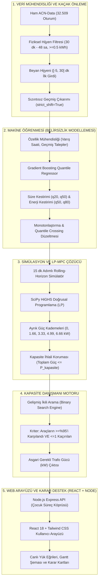

<div align="center">

# ⚡ ŞarjDenge AI
### Trafo Kapasitesi Altında EV Şarj Planlama ve Dinamik Kapasite Danışmanı

**Climathon 2026 — Siemens Tech Career Days Top 20 Finalist & COP31 Adayı**

[](https://www.python.org/)
[](https://nodejs.org/)
[](https://react.dev/)
[](https://scipy.org/)
[](https://docs.pytest.org/)
[](https://playwright.dev/)
[](LICENSE)

*“Kaç kW trafo yeter?” sorusuna gerçek telemetri ve optimizasyonla cevap veren, bilimsel doğrulaması şeffafça raporlanmış akıllı şarj karar destek sistemi.*

---

[Canlı Demo](#-canlı-bağlantılar-live-demo) • [Ürün Özellikleri](#-ürün-özellikleri) • [Sistem Mimarisi](#-sistem-ve-optimizasyon-mimarisi) • [Scrum Süreci](#-agile--scrum-yönetimi-tek-kişilik-ekip-uyarlaması) • [Doğrulama & Hipotez](#-bilimsel-doğrulama-ve-dürüst-hipotez-sonuçları) • [Kurulum](#-kurulum-ve-çalıştırma)

</div>

---

## 👥 Takım

| Fotoğraf / Avatar | İsim Soyisim | Rol ve Sorumluluklar | İletişim |
| :---: | :--- | :--- | :--- |
| 👩‍💻 | **Büşra Demir** | **Product Owner & Scrum Master & Full-Stack AI Developer**<br>*(Tek kişilik bağımsız ekip)*<br>• Veri Mühendisliği ve Kaçak Önleme Protokolü<br>• Quantile Regresyon & SciPy HiGHS LP-MPC Çözücüsü<br>• Node.js Express API & React Vite Karar Destek Arayüzü<br>• Bilimsel Denetim, E2E Test Otomasyonu ve Dağıtım | [](https://github.com/busrademirrr) [](https://linkedin.com) |

> **Tek Kişilik Ekipte Scrum Uyarlaması:** Proje süreci boyunca Agile prensipleri korunmuş; PO (kapsam ve senaryo yönetimi), Scrum Master (sprint planlama, engel kaldırma ve retrospektif) ve Developer (mimari geliştirme ve test) rolleri şeffaf sprint günlükleriyle belgelenmiştir.

---

## 🎯 Ürün Açıklaması

Elektrikli araç (EV) dönüşümünde apartman siteleri, iş yeri kampüsleri ve otopark işletmecileri büyük bir altyapı darboğazıyla karşılaşmaktadır: **Aynı anda şarja takılan onlarca araç, tesisin mevcut trafo ve bağlantı kapasitesini aşarak yüksek tepe aşım cezalarına (peak penalty) ve şebeke kesintilerine yol açar.** Yeni trafo yatırımı (CapEx) ise aylar süren bürokratik onaylar ve milyonlarca liralık maliyet demektir.

**ŞarjDenge AI**, tesisin trafo kapasitesini bir sınır olarak kabul eder ve **"Bu kapasiteyi 1 Watt bile aşmadan, araçların şarj hedefini maksimum seviyede nasıl karşılarız?"** ve **"Belirli bir araç filosu için gereken asgari trafo kapasitesi kaç kW'tır?"** sorularını çözer.

Sistem; ham telemetri verisindeki kullanıcı belirsizliklerini **Gradient Boosting Quantile Regressor ($q_{20}, q_{50}, q_{80}$)** ile modeller, **15 dakikalık adımlarla Model Öngörülü Kontrol (LP-MPC)** ile dinamik güç tahsisi yapar ve **Kapasite Danışmanı** motoru ile tesis yöneticilerine yatırım yapmadan önce gereken asgari gücü nokta atışıyla raporlar.

---

## 🔗 Canlı Bağlantılar (Live Demo)

- 🌐 **Canlı Web Uygulaması:** `https://sarjdenge-ai.onrender.com` *(veya yerel Cloudflare tüneli)*
- ⚙️ **Canlı Backend API Sağlık Kontrolü:** `https://sarjdenge-ai.onrender.com/api/health`
- 📹 **2 Dakikalık Jüri Tanıtım Videosu (YouTube):** [ŞarjDenge AI — Ürün Tanıtımı ve Canlı Demo](https://youtu.be/placeholder)
- 📋 **Proje Tasarım İncelemesi (PDR Dokümanı):** [`docs/PROJE_GENEL_FAALIYET_VE_SONUC_RAPORU.md`](docs/PROJE_GENEL_FAALIYET_VE_SONUC_RAPORU.md)

---

## ✨ Ürün Özellikleri

### 1. Canlı Karar Destek Simülatörü
- **Gerçek ve Sentetik Saha Seçimi:** NASA JPL / Caltech ACN-Data gerçek saha verisi ile Türkiye İş Yeri Kampüsü, Karma Yerleşke ve Apartman senaryoları arasında anında geçiş.
- **24 Saatlik 96 Adımlı Güç Eğrisi:** Her 15 dakikalık adımda şebeke tavanı ($P_{\text{kapasite}}$) ile yöntemlerin anlık güç tüketimini interaktif grafikte canlı izleme.
- **Sıfır İhlal Güvencesi:** Tüm algoritmalar kapasite kısıtını %100 sağlar; 1 Watt dahi aşım yapılamaz ($0$ kapasite ihlali).

### 2. Canlı Kapasite Danışmanı (Capacity Advisor)
- **"Kaç kW Trafo Yeter?" Analizi:** İkili arama (binary search) algoritması ile şarj başarısını ($\ge \%95$ araç tamamlama ve $\le 1$ kaçırılan) sağlayan **asgari trafo gücünü (kW)** bulur.
- **Tek Günlük Hızlı Mod (10–12 sn):** Belirli bir güne ait soket ve filo dağılımı için anlık kapasite reçetesi çıkarır.
- **Çok Günlü Geniş Analiz ($\ge 20$ Gün):** Geniş takvim kesitinde medyan, p10 ve p90 kapasite gereksinimlerini hesaplayarak uzun vadeli trafo boyutlandırma güvencesi sunar.
- **Fiziksel İmkânsız Araç Ayrıştırması:** İstasyonda kalış süresi boyunca şebeke sınırsız olsa dahi bataryasını dolduramayacak araçları otomatik tespit eder ve başarı oranını fiziksel olarak karşılanabilir araçlar üzerinden netleştirir.

### 3. Çok Yöntemli Benchmark (9 Algoritma Kıyaslaması)
- Kural Tabanlı: **FCFS** (İlk Gelen İlk Şarj), **EDF** (En Erken Ayrılacak Olan), **LLF** (En Az Esnekliği Olan), **Eşit Paylaşım (Statik)**.
- Optimizasyon Tabanlı: **MPC-Beyan** (Kullanıcı beyanına dayalı LP), **MPC-Tahmin** (Güvenli/Dengeli/Nokta model kestirimli LP), **Hibrit Asimetrik Kurallar**.

### 4. Telemetri ve Açıklanabilirlik ("Neden?" Paneli)
- Her araç için geliş saati, ayrılış saati, teslim edilen enerji, şarj durumu ve ayrılış anı şarj oranı (%) telemetrisi.
- Güç kısılmasının fiziksel gerekçesi (Trafo kısıtı mı, soket üst sınırı mı, araç talebi bitti mi?) adım adım sunulur.

---

## 🏗️ Sistem ve Optimizasyon Mimarisi



---

## 💻 Teknoloji Yığını

| Katman | Teknoloji / Kütüphane | Kullanım Amacı |
| :--- | :--- | :--- |
| **Frontend** | React 18, Vite, Tailwind CSS, Lucide Icons | Modern, duyarlı ve reaktif karar destek kullanıcı arayüzü |
| **Backend API** | Node.js (v20), Express.js | REST API uç noktaları, process spawning ve istek orkestrasyonu |
| **Optimizasyon Motoru** | Python 3.11+, SciPy (`scipy.optimize.linprog`, HiGHS solver) | 15 dakikalık adımlarla Model Öngörülü Kontrol (MPC) doğrusal programlama |
| **Makine Öğrenmesi** | Scikit-learn (`GradientBoostingRegressor`, `HistGradientBoosting`) | Ayrılış süresi ve enerji talebi için quantile regresyon ($q_{20}, q_{50}, q_{80}$) |
| **Veri Analitiği** | NumPy, Pandas, PyYAML | Zaman serisi manipülasyonu, ACN-Data temizliği ve konfigürasyon yönetimi |
| **Test & Kalite** | Pytest, Node Test Runner, Playwright E2E | Çekirdek matematiksel değişmezler, API regresyonu ve gerçek tarayıcı testleri |
| **Konteyner & Dağıtım** | Docker, Docker Compose, Cloudflare Tunnel | Taşınabilir üretim imajı ve sıfır gecikmeli canlı tünel |

---

## 📅 Agile & Scrum Yönetimi (Tek Kişilik Ekip Uyarlaması)

Proje 27 Eylül – 25 Ekim 2026 tarihleri arasında **4 haftalık sprint döngüsüyle** geliştirilmiştir.

```
Sprint 1 (27 Eyl – 03 Eki)  ──►  Sprint 2 (04 – 10 Eki)  ──►  Sprint 3 (11 – 17 Eki)  ──►  Sprint 4 (18 – 25 Eki)
Temel Simülatör & Veri          Quantile ML & HiGHS MPC        2020 Holdout & Web UI          Kapasite Danışmanı & Teslim
```

### Sprint Özet Tablosu

| Sprint | Tarih Aralığı | Odak & Ana Hedef | Tahmini SP | Tamamlanan SP | Durum |
| :--- | :--- | :--- | :---: | :---: | :---: |
| [**Sprint 1**](sprints/sprint-1.md) | 27 Eyl – 03 Eki | Problem tanımı, ACN-Data hijyen şelalesi, 15 dk temel simülatör | 35 SP | 35 SP | ✅ Tamamlandı |
| [**Sprint 2**](sprints/sprint-2.md) | 04 – 10 Eki | Quantile ML modelleri ($q_{20}, q_{80}$), HiGHS LP-MPC, ön kayıt protokolü | 40 SP | 40 SP | ✅ Tamamlandı |
| [**Sprint 3**](sprints/sprint-3.md) | 11 – 17 Eki | 2020 holdout analizi, Türkiye sentetik senaryoları, React + Node.js UI | 45 SP | 45 SP | ✅ Tamamlandı |
| [**Sprint 4**](sprints/sprint-4.md) | 18 – 25 Eki | Canlı Kapasite Danışmanı (ikili arama), erratum düzeltmesi, E2E testler, deploy | 42 SP | 42 SP | ✅ Tamamlandı |

---

### Sprint 1 Detayı (27 Eylül – 03 Ekim 2026)
- **Kapsam:** Ham ACN telemetrisinde (32.509 satır) kısa oturumlar (<30 dk), aşırı uzun oturumlar (>48 sa) ve düşük enerji (<0.5 kWh) filtrelendi. Kullanıcı ilk beyanını yakalayan sızıntısız veri yükleyici (`sarjdenge/data.py`) yazıldı. 15 dakikalık adımlarla FCFS, EDF ve LLF kural tabanlı simülatör geliştirildi.
- **Sprint Review:** 14.219 fiziksel temiz oturum elde edildi. Ayrık güç seviyelerinde (0, 1.66, 3.33, 4.99, 6.66 kW) sıfır kapasite ihlali kuralı doğrulandı.
- **Sprint Retrospective:** Kural tabanlı yöntemlerin tepe gücü sınırlandırmada başarılı olduğu ancak kullanıcı ayrılış sürelerini dikkate almadığı tespit edildi; Sprint 2'de ML ve MPC entegrasyonu kararlaştırıldı.

---

### Sprint 2 Detayı (04 – 10 Ekim 2026)
- **Kapsam:** Gradient Boosting Quantile Regressor ile süre ($q_{20}, q_{50}$) ve enerji ($q_{50}, q_{80}$) tahmin hattı kuruldu. `scipy.optimize.linprog` (HiGHS) tabanlı Model Öngörülü Kontrol (MPC) geliştirildi. Ana hipotez önceden kilitlendi ([`ONKAYIT_2.md`](ONKAYIT_2.md)): $\Delta = \text{mpc\_tahmin\_guvenli} - \text{mpc\_beyan} \ge +0.02$ ve %95 GA alt sınırı > 0.
- **Sprint Review:** 2019 H1 eğitim/doğrulama setinde enerji MAE'si kullanıcı beyanında 10.40 kWh iken model ile 3.49 kWh'ye düşürüldü.
- **Sprint Retrospective:** Makine öğrenmesi hata oranını düşürse de dar kapasitede zamanında hedefe ulaşma oranına beklenen katkıyı vermediği gözlendi; Sprint 3'te bağımsız 2020 holdout testi planlandı.

---

### Sprint 3 Detayı (11 – 17 Ekim 2026)
- **Kapsam:** Dokunulmamış 2020 Holdout kümesi (4.043 oturum, 108 gün-saha) üzerinde hipotez testleri icra edildi. Türkiye elektrikli araç şarj alışkanlıklarını temsil eden 3 sentetik senaryo (`sarjdenge/sentetik_v2.py`, `turkiye.py`) modellendi. React 18 ve Express tabanlı modern web arayüzü inşa edildi.
- **Sprint Review:** 2020 holdout sonuçlarında H1 hipotezinin reddedildiği şeffafça belgelendi. Web panelinde 24 saatlik yük eğrisi, Gantt şeması ve "Neden?" telemetrisi çalışır hale getirildi.
- **Sprint Retrospective:** Web arayüzünün yalnızca simülasyon göstermesinin yetersiz olduğu, site yöneticilerine doğrudan "kaç kW trafo almalıyım?" cevabını veren bir danışman motoru eklenmesi kararlaştırıldı.

---

### Sprint 4 Detayı (18 – 25 Ekim 2026)
- **Kapsam:** İkili arama algoritması ile çalışan "Canlı Kapasite Danışmanı" (Capacity Advisor) geliştirildi. 22 Ekim'de simülasyon girdi indekslemesindeki teknik hata tespit edildi ve erratum ile düzeltildi. Tek günlük ve çok günlü modlar optimize edildi (10 sn yanıt süresi). Dockerfile ve Cloudflare dağıtım altyapısı kuruldu. 17/17 Playwright E2E testi tamamlandı.
- **Sprint Review:** Kapasite Danışmanı tek günlükte ~10 saniyede, 20 günlük sentetik analizde ~57 saniyede tamamlandı. Türkiye apartman senaryosunda 15 kW kapasiteyle 20 aracın %100 hedefe ulaştığı doğrulandı.
- **Sprint Retrospective:** Proje tüm bilimsel dürüstlük standartları, test otomasyonu ve çalışan canlı uygulamasıyla teslim aşamasına getirildi.

---

## 📊 Bilimsel Doğrulama ve Dürüst Hipotez Sonuçları

ŞarjDenge AI projesinde hiçbir deneysel sonuç manipüle edilmemiş; negatif çıkan hipotezler başarı gibi gösterilmeden doğrudan bilimsel bir bulgu olarak raporlanmıştır.

### Ön Kayıtlı Ana Hipotez (H1) Değerlendirmesi
> **Hipotez:** Güvenli ($q_{80}$) enerji tahmini kullanan MPC, kullanıcı beyanını kullanan MPC'den en az $+2.0$ yüzde puanı daha yüksek araç tamamlama oranı sağlar ($\Delta \ge +0.02$) ve %95 Bootstrap Güven Aralığı alt sınırı $> 0$'dır.

| Test Dönemi | Oturum Sayısı ($N$) | Gün-Saha | Kapasite ($f$) | Ortalama Fark ($\Delta$) | %95 Bootstrap Güven Aralığı | Karar |
| :--- | :---: | :---: | :---: | :---: | :---: | :---: |
| **2019 H1 (Doğrulama)** | 5.207 | 68 | $f = 0.5$ (Dar) | **$-2.22$ puan** | $[-2.97, -1.54]$ | ❌ **Desteklenmedi** |
| **2019 H1 (Doğrulama)** | 5.207 | 68 | $f = 0.7$ (Orta) | **$-0.58$ puan** | $[-1.06, -0.10]$ | ❌ **Desteklenmedi** |
| **2019 H2 (Dönemler Arası)** | 11.911 | 148 | $f = 0.5$ (Dar) | **$-2.05$ puan** | $[-2.55, -1.53]$ | ❌ **Desteklenmedi** |
| **2020 Holdout** | 4.043 | 108 | $f = 0.5$ (Dar) | **$-1.35$ puan** | $[-2.55, -0.18]$ | ❌ **Desteklenmedi** |
| **2020 Holdout** | 4.043 | 108 | $f = 0.9$ (Geniş) | **$+0.05$ puan** | $[-0.12, +0.22]$ | ❌ **Desteklenmedi** |

### Neden Desteklenmedi? (Mekanizma Analizi)
- **Hayalet Kapasite Rezervasyonu Mekanizması:** Güvenli modelleme amacıyla seçilen yüksek enerji hedefi ($q_{80}$), oturumların yaklaşık %12'sinde gerçek ihtiyacın üzerinde kalmaktadır. Dar kapasitede LP çözücüsü bu araçlara erken saatlerde agresif güç ayırır; araç erken ayrıldığında rezerve edilen bu kapasite diğer araçların şarjını kısıtlamış olur.
- **Kullanıcı Beyanı Tamponu:** Gerçek sürücüler iş yerinde 7–8 saat kalırken ihtiyaçları 2.5–3 saatte dolmaktadır. Aradaki 4–5 saatlik boş bekleme süresi, sürücülerin beyan hatalarını doğal olarak absorbe etmektedir.
- **Önemli Çıkarım:** Makine öğrenmesi tahmin doğruluğunun artması (MAE 10.4 kWh'den 3.5 kWh'ye düştü), saf LP optimizasyonunda her zaman daha yüksek şarj başarısına dönüşmemektedir. Kullanıcı beyanına dayalı **EDF (En Erken Ayrılacak Olan)** algoritması en dengeli ve güvenilir yöntem olarak öne çıkmaktadır.

---

## 🚀 Kurulum ve Çalıştırma

### Gereksinimler
- Python 3.11 veya 3.12
- Node.js v20+ ve npm
- Git

### 1. Depoyu Klonlayın
```bash
git clone https://github.com/busrademirrr/sarjdenge-ai.git
cd "climathon v2"
```

### 2. Python Motoru Kurulumu
```bash
# Bağımlılıkları yükleyin
pip install -r requirements.txt

# Çekirdek testleri çalıştırın
pytest tests/ -q
```

### 3. Backend ve Frontend Kurulumu
```bash
# Backend bağımlılıkları (web/server)
cd web/server
npm install

# Frontend bağımlılıkları ve derleme (web/client)
cd ../client
npm install
npm run build
cd ../..
```

### 4. Tek Komutla Canlıya Alma (Express Monolith)
Backend sunucusu derlenmiş frontend'i statik olarak sunar:
```bash
node web/server/index.js
```
Tarayıcınızdan **`http://localhost:5000`** adresine gidin.

---

## 🧪 Test Kapsamı ve Doğrulama

Sistem çok katmanlı test otomasyonu ile korunmaktadır:

```bash
# 1. Python Çekirdek & Matematiksel Değişmez Testleri (56 test)
pytest tests/test_kapasite_danismani.py tests/test_web_servis.py tests/test_veri_hijyeni.py -v

# 2. Express API Uç Nokta Testleri (8 test)
node --test web/server/tests/server.test.js

# 3. Playwright Gerçek Tarayıcı E2E Testleri (17 test)
npm run test:advisor:e2e --prefix web/client
npm run test:hypothesis:e2e --prefix web/client
```

---

## 📁 Depo Dizin Yapısı

```
climathon-v2/
├── sarjdenge/                  # Çekirdek Python Kütüphanesi
│   ├── sim.py                  # 15 dk adımlı simülatör & kural tabanlı planlayıcılar
│   ├── modeller.py             # SciPy HiGHS LP-MPC optimizasyon modeli
│   ├── tahmin.py               # Quantile Regresyon (Gradient Boosting) modelleri
│   ├── web_servis.py           # Node.js API ve CLI köprüsü & Kapasite Danışmanı motoru
│   ├── veri_hijyeni.py         # Sızıntısız veri temizleme şelalesi
│   ├── turkiye.py              # Sentetik Türkiye senaryoları üreticisi
│   └── sentetik_v2.py          # Parametrik senaryo jeneratörü
├── web/
│   ├── server/                 # Node.js Express API Servisi
│   │   ├── routes/             # simulate, capacityAdvisor, scenarios, benchmark
│   │   └── index.js            # Sunucu giriş noktası ve statik dosya sunumu
│   └── client/                 # React 18 + Vite + Tailwind CSS Frontend
│       ├── src/components/     # CapacityAdvisor, GanttChart, PowerCurveChart, KpiCards
│       └── tests/              # Playwright E2E test suitleri
├── sprints/                    # Scrum Dokümantasyonu (Sprint 1, 2, 3, 4)
│   ├── sprint-1.md             # Sprint 1 Backlog, Review, Retrospective
│   ├── sprint-2.md             # Sprint 2 Backlog, Review, Retrospective
│   ├── sprint-3.md             # Sprint 3 Backlog, Review, Retrospective
│   └── sprint-4.md             # Sprint 4 Backlog, Review, Retrospective
├── config/                     # Dışsal Senaryo ve Beyan Oranları Yapılandırması
├── docs/                       # Bilimsel Raporlar, Mimari ve Dağıtım Belgeleri
│   ├── PROJE_GENEL_FAALIYET_VE_SONUC_RAPORU.md
│   ├── HOLDOUT_2020_DEGERLENDIRME_RAPORU.md
│   ├── MODEL_KARSILASTIRMA_RAPORU.md
│   └── DEPLOY.md
├── Dockerfile                  # Üretim Docker İmajı
├── docker-compose.yml          # Yerel konteyner orkestrasyonu
├── requirements.txt            # Python bağımlılıkları
└── README.md                   # Ana Depo Dokümantasyonu
```

---

## 📜 Lisans ve Kaynakça

- **Lisans:** Bu proje MIT Lisansı altında sunulmaktadır.
- **Veri Kaynağı & Atıf:** ACN-Data şarj oturumları Kaliforniya Teknoloji Enstitüsü (Caltech) ve Jet İtki Laboratuvarı (JPL) sahalarından alınmıştır:
  *Lee, Z. J., Li, G. X., & Low, S. H. (2019). ACN-Data: Analysis and Applications of an Open EV Charging Dataset. Proceedings of the Tenth ACM International Conference on Future Energy Systems.*
- **Geliştirici:** Büşra Demir (Climathon 2026 Finalisti).
