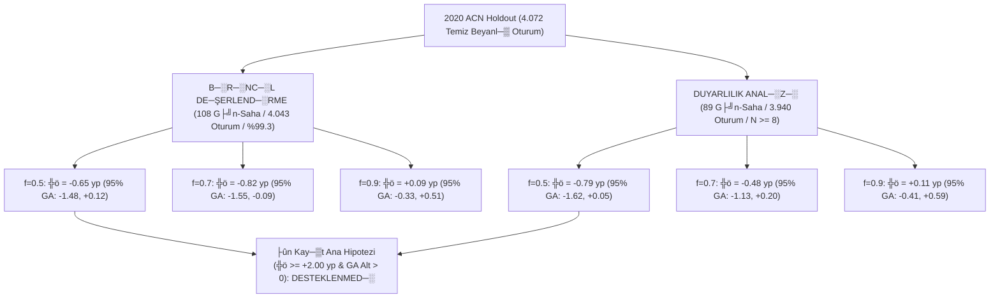

# ┼ŞarjDenge AI ÔÇö 2020 ACN Holdout Nihai De─şerlendirme ve Hipotez Testi Raporu

**Tarih:** 18 Ekim 2026
**Protokol:** ├ûn Kay─▒t 2 ([`ONKAYIT_2.md`](file:///c:/Users/HP-PC/OneDrive/Pictures/Desktop/climathon%20v2/ONKAYIT_2.md)) ÔÇó Se├ğenek A (2019 Tam Yeniden E─şitim)
**Holdout Verisi:** [`data/holdout_2020_01_02/acn_holdout_20200101_20200301_ham.csv`](file:///c:/Users/HP-PC/OneDrive/Pictures/Desktop/climathon%20v2/data/holdout_2020_01_02/acn_holdout_20200101_20200301_ham.csv) (1 Ocak ÔÇô 1 Mart 2020)
**De─şerlendirme Kapsam─▒:**
- **Birincil De─şerlendirme (├ûn Kay─▒tl─▒):** T├╝m uygun g├╝nler (`min_arac_gunluk=1`, sim├╝lat├Âr alt s─▒n─▒r─▒ $\ge 4$ ara├ğ sa─şlayan **108 g├╝n-saha, 4.043 oturum, %99.3 kapsam**)
- **Duyarl─▒l─▒k Analizi (Ek Filtre):** $N \ge 8$ ara├ğ/g├╝n filtresi uygulanan **89 g├╝n-saha, 3.940 oturum, %96.8 kapsam**
**Tohum ve ─░terasyon:** `tohum=42`, `n_boot=2000`, `kapasiteler=(0.5, 0.7, 0.9)`

---

## 1. Y├Ânetici ├ûzeti ve ├ûn Kay─▒t Hipotez Karar─▒

| Kriter / ├ûn Kay─▒t ┼Şart─▒ | Hedef E┼şik | Birincil De─şerlendirme (T├╝m Uygun G├╝nler - 4.043 Oturum) | Duyarl─▒l─▒k Analizi ($N \ge 8$ G├╝nler - 3.940 Oturum) | Nihai Karar |
| :--- | :---: | :---: | :---: | :---: |
| **Ana Hipotez Fark─▒ ($f=0.5$)** | $\ge +2.00$ yp | **-0.65 yp** (GA: $[-1.48, +0.12]$) | **-0.79 yp** (GA: $[-1.62, +0.05]$) | ÔØî **DESTEKLENMED─░** |
| **Ana Hipotez Fark─▒ ($f=0.7$)** | $\ge +2.00$ yp | **-0.82 yp** (GA: $[-1.55, -0.09]$) | **-0.48 yp** (GA: $[-1.13, +0.20]$) | ÔØî **DESTEKLENMED─░** |
| **Ana Hipotez Fark─▒ ($f=0.9$)** | $\ge +2.00$ yp | **+0.09 yp** (GA: $[-0.33, +0.51]$) | **+0.11 yp** (GA: $[-0.41, +0.59]$) | ÔØî **DESTEKLENMED─░** |
| **Bootstrap %95 GA Alt S─▒n─▒r─▒** | $> 0.0$ | $f=0.5$: -1.48 ÔÇó $f=0.7$: -1.55 ÔÇó $f=0.9$: -0.33 | $f=0.5$: -1.62 ÔÇó $f=0.7$: -1.13 ÔÇó $f=0.9$: -0.41 | ÔØî **DESTEKLENMED─░** |
| **Enerji $q_{80}$ Kapsam Tolerans─▒** | $\%80 \pm 3$ | **%82.39** ($[77\%, 83\%]$ i├ğinde) | **%82.39** ($[77\%, 83\%]$ i├ğinde) |  **Tolerans ─░├ği** |
| **S├╝re $q_{20}$ Kapsam Kalibrasyonu** | $\%20$ hedef | **%19.99** | **%19.99** |  **Hedefe Uyumlu** |
| **Kapasite ─░hlali** | $0$ | **0 ─░hlal** (2.916 sim├╝lasyon ko┼şusu) | **0 ─░hlal** (2.403 sim├╝lasyon ko┼şusu) |  **K─▒s─▒t Korundu** |

> [!IMPORTANT]
> **DÜRÜST BİLİMSEL SONUÇ BİLDİRİMİ:**
> ├ûnceden kaydedilen **ana hipotez (`mpc_tahmin_guvenli - mpc_beyan >= +0.02` ve GA alt ucu > 0), hem birincil de─şerlendirmede (t├╝m uygun g├╝nler) hem de duyarl─▒l─▒k analizinde ($N \ge 8$) KES─░N OLARAK DESTEKLENMEM─░┼ŞT─░R.**
> Makine ├Â─şrenmesi modelleri kullan─▒c─▒ beyan─▒na k─▒yasla s├╝re mutlak hatas─▒n─▒ **%45.7**, enerji mutlak hatas─▒n─▒ **%69.7** oran─▒nda d├╝┼ş├╝rm├╝┼ş ve quantile kalibrasyonu sa─şlam─▒┼ş olsa da; bu do─şruluk art─▒┼ş─▒ saf enerji-LP tabanl─▒ MPC mimarisinde zaman─▒nda hedef tamamlama oran─▒na pozitif katk─▒ yapmam─▒┼ş, dar kapasitede ($f=0.5$) beyan─▒n **0.65 y├╝zde puan─▒ gerisinde** kalm─▒┼şt─▒r ($f=0.7$'de ise beyan, tahmine kar┼ş─▒ istatistiksel olarak anlaml─▒ bi├ğimde **0.82 y├╝zde puan─▒ daha ba┼şar─▒l─▒d─▒r**; %95 GA $[-1.55, -0.09]$).

> [!NOTE]
> **Metodolojik S─▒n─▒rlar ve Veri Tan─▒mlar─▒:**
> 1. **`kWhDelivered` Tan─▒m─▒:** ACN veri taban─▒ndaki `kWhDelivered` alan─▒ arac─▒n ger├ğek toplam batarya kapasitesini veya toplam enerji ihtiyac─▒n─▒ de─şil; ┼şarj oturumunda EVSE taraf─▒ndan araca fiilen teslim edilen enerji miktar─▒n─▒ temsil eder.
> 2. **2020 Verisinin Durumu:** Bu de─şerlendirme ile 2020 d├Ânemi verileri incelenmi┼ş ve sonu├ğlar─▒ raporlanm─▒┼şt─▒r. Dolay─▒s─▒yla bu veri k├╝mesi gelecekteki model se├ğimi veya hiperparametre optimizasyonu i├ğin art─▒k **dokunulmam─▒┼ş test seti olarak adland─▒r─▒lamaz**.
> 3. **Resmi D─▒┼şlama ┼Şelalesi:** Ham 4.553 oturum (1 ba┼şl─▒k sat─▒r─▒ ile 4.554 sat─▒r: 1.670 Caltech + 2.883 JPL) ├╝zerinden resmi kilitli kod (`sarjdenge/veri_hijyeni.py`) ile yap─▒lan elemede: 62 k─▒sa (<30 dk), 3 a┼ş─▒r─▒ uzun (>48 sa) ve 0 yetersiz enerji (<0.5 kWh) olmak ├╝zere toplam 65 oturum elenmi┼ş ve 4.488 fiziksel temiz oturum elde edilmi┼ştir. Ard─▒ndan eksik beyan (-379) ve gecikmi┼ş beyan (-37) filtreleri uygulanarak nihai **4.072** temiz beyanl─▒ oturuma ula┼ş─▒lm─▒┼şt─▒r. Eski bir ara d├Âk├╝mde sehven ge├ğen 2.417 say─▒s─▒ ham sat─▒r say─▒s─▒ de─şil, g├╝nl├╝k ├ğ─▒kt─▒ tablosundaki bir alt transkripsiyondur.
> 4. **─░statistiksel Karar Dili:** ├ûnceden tan─▒mlanan karar kural─▒na g├Âre s─▒f─▒r hipotezi ($H_0$) reddedilememi┼ştir; tahmin destekli MPC'nin kullan─▒c─▒ beyan─▒na ├╝st├╝n oldu─şunu g├Âsteren istatistiksel olarak anlaml─▒ bir kan─▒t saptanamam─▒┼şt─▒r.
> 5. **2021 ─░leriye D├Ân├╝k Deney S─▒n─▒r─▒:** ACN-Data portal─▒na harici eri┼şim sorunu nedeniyle 2021 ileriye d├Ân├╝k veri envanteri ve deneyi ger├ğekle┼ştirilememi┼ştir; bu durum projenin g├╝ncel veri s─▒n─▒r─▒ olarak kaydedilmi┼ştir.

---

## 2. Örneklem Kapsamı ve Simülasyon Uygunluk Analizi

Daha ├Ânce de─şerlendirilmi┼ş 2020 holdout veri setinde (1 Ocak ÔÇô 1 Mart 2020) temiz beyanl─▒ toplam **4.072 oturum**, 61 takvim g├╝n├╝nde ve 122 `(siteID, gun)` ├ğiftinde yer almaktad─▒r:

| K├╝me / K─▒s─▒t | G├╝n-Saha ├çifti | Takvim G├╝n├╝ | Oturum Say─▒s─▒ | Kapsam Oran─▒ | A├ğ─▒klama |
| :--- | :---: | :---: | :---: | :---: | :--- |
| **Toplam Temiz Beyanl─▒ Test Oturumu** | 122 | 61 | **4,072** | %100.0 | T├╝m ge├ğerli test evreni |
| **B─░R─░NC─░L DE─ŞERLEND─░RME (T├╝m Uygun G├╝nler)** | **108** | **59** | **4,043** | **%99.3** | Sim├╝lat├Âr alt s─▒n─▒r─▒n─▒ ($\ge 4$ ara├ğ) sa─şlayan t├╝m g├╝nler |
| *ÔÇö Sim├╝lasyon D─▒┼ş─▒ Kalan G├╝nler* | 14 | 14 | 29 | %0.7 | Hafta sonu / tatil g├╝nlerinde sahada 1, 2 veya 3 ara├ğ bulunan g├╝nler |
| **DUYARLILIK ANAL─░Z─░ ($N \ge 8$ G├╝nler)** | **89** | **48** | **3,940** | **%96.8** | G├╝nl├╝k yo─şun otopark filtresi |

### Sim├╝lasyon D─▒┼ş─▒ Kalan 29 Oturumun Nedeni (Teknik S─▒n─▒r ┼Şeffafl─▒─ş─▒):
Deney ko┼şucusunda ([`sarjdenge/deney_v2.py`](file:///c:/Users/HP-PC/OneDrive/Pictures/Desktop/climathon%20v2/sarjdenge/deney_v2.py#L104)), ayn─▒ anda sahada ba─şl─▒ ara├ğ say─▒s─▒ 4'ten az oldu─şunda (`gec.sum() < 4`) fonksiyon `return []` d├Ânmektedir (1-3 arac─▒n bulundu─şu hafta sonu n├Âbet├ği ┼şarjlar─▒nda trafo kapasitesi hi├ğbir zaman darbo─şaza girmez). Bu ko┼şul `sim.py` i├ğinde de─şil, deney ko┼şucusu `deney_v2.py` i├ğindedir. Bu nedenle 14 g├╝n-saha ├ğiftindeki 29 oturum sim├╝lasyon d─▒┼ş─▒ kalm─▒┼ş; teknik olarak ├ğal─▒┼şt─▒r─▒labilen geriye kalan **4.043 oturumun tamam─▒ (%99.3)** birincil de─şerlendirmeye dahil edilmi┼ştir.

---

## 3. Birincil De─şerlendirme Sonu├ğlar─▒ (T├╝m Uygun G├╝nler - 4.043 Oturum, 108 G├╝n-Saha)

### A. Y├Ântem Performans Tablosu

| Kapasite ($f$) | Y├Ântem | T├╝r / Kaynak | Ba┼şar─▒ Oran─▒ (`ok`) | Teslim Oran─▒ | Erken Ayr─▒lan Ba┼şar─▒ | En K├Ât├╝ %10 (`p10`) | Kapasite ─░hlali |
| :---: | :--- | :--- | :---: | :---: | :---: | :---: | :---: |
| **0.5** | **`edf_beyan`** | Kural / Beyan | **%86.44** | %93.64 | %71.48 | 0.881 | 0 |
| 0.5 | **`edf_tahmin_guvenli`** | Kural / Tahmin | **%86.00** | %93.63 | **%73.90** | 0.867 | 0 |
| 0.5 | `llf_beyan` | Kural / Beyan | %85.78 | %93.50 | %70.48 | 0.860 | 0 |
| 0.5 | `llf_tahmin_guvenli` | Kural / Tahmin | %85.32 | %93.66 | %72.07 | **0.873** | 0 |
| 0.5 | **`mpc_beyan` (REF)** | Optimizasyon / Beyan | **%85.28** | %93.29 | %71.06 | 0.858 | 0 |
| 0.5 | `mpc_hibrit_asimetrik` | Ke┼şifsel / Hibrit | %84.72 | %93.16 | %72.26 | 0.851 | 0 |
| 0.5 | **`mpc_tahmin_guvenli` (ANA)**| Optimizasyon / Tahmin | **%84.63** | %93.19 | %71.77 | 0.846 | 0 |
| 0.5 | `mpc_tahmin_ortanca` | Optimizasyon / Tahmin | %84.03 | %92.96 | %70.53 | 0.845 | 0 |
| 0.5 | `fcfs_beyan` | S─▒ral─▒ / Beyan | %83.42 | %92.78 | %70.49 | 0.795 | 0 |
| | | | | | | | |
| **0.7** | **`edf_beyan`** | Kural / Beyan | **%90.62** | %97.08 | %79.30 | 0.953 | 0 |
| 0.7 | `llf_tahmin_guvenli` | Kural / Tahmin | %90.58 | %97.04 | %79.08 | 0.944 | 0 |
| 0.7 | `llf_beyan` | Kural / Beyan | %90.55 | %96.95 | %78.89 | 0.944 | 0 |
| 0.7 | **`mpc_beyan` (REF)** | Optimizasyon / Beyan | **%90.26** | %96.69 | %79.03 | 0.936 | 0 |
| 0.7 | `edf_tahmin_guvenli` | Kural / Tahmin | %90.15 | %96.95 | **%79.80** | 0.941 | 0 |
| 0.7 | `mpc_hibrit_asimetrik` | Ke┼şifsel / Hibrit | %89.70 | %96.78 | %78.82 | 0.933 | 0 |
| 0.7 | **`mpc_tahmin_guvenli` (ANA)**| Optimizasyon / Tahmin | **%89.44** | **%96.85** | %78.39 | 0.932 | 0 |
| 0.7 | `fcfs_beyan` | S─▒ral─▒ / Beyan | %88.47 | %96.64 | %77.90 | 0.918 | 0 |
| | | | | | | | |
| **0.9** | **`edf_tahmin_guvenli`** | Kural / Tahmin | **%93.34** | %98.71 | **%84.49** | **0.979** | 0 |
| 0.9 | `llf_tahmin_guvenli` | Kural / Tahmin | %93.30 | **%98.74** | %84.31 | 0.978 | 0 |
| 0.9 | **`mpc_tahmin_guvenli` (ANA)**| Optimizasyon / Tahmin | **%93.19** | %98.68 | %84.10 | 0.977 | 0 |
| 0.9 | `fcfs_beyan` | S─▒ral─▒ / Beyan | %93.14 | %98.73 | %84.37 | 0.978 | 0 |
| 0.9 | `llf_beyan` | Kural / Beyan | %93.14 | %98.61 | %83.94 | 0.975 | 0 |
| 0.9 | **`mpc_beyan` (REF)** | Optimizasyon / Beyan | **%93.10** | %98.59 | %83.70 | 0.975 | 0 |
| 0.9 | `edf_beyan` | Kural / Beyan | %93.09 | %98.68 | %83.74 | 0.977 | 0 |
| 0.9 | `mpc_hibrit_asimetrik` | Ke┼şifsel / Hibrit | %92.81 | %98.56 | %83.49 | 0.975 | 0 |

### B. E┼şle┼ştirilmi┼ş Bootstrap Hipotez Testi Sonu├ğlar─▒ ($B=2000$)

| Kapasite ($f$) | Kar┼ş─▒la┼şt─▒rma | T├╝r | Ortalama Fark ($\Delta$) | %95 G├╝ven Aral─▒─ş─▒ Alt | %95 G├╝ven Aral─▒─ş─▒ ├£st | E┼şik Kar┼ş─▒land─▒ m─▒? | Karar |
| :---: | :--- | :--- | :---: | :---: | :---: | :---: | :---: |
| **0.5** | **`mpc_tahmin_guvenli - mpc_beyan`** | **Ana Hipotez** | **-0.65 yp** | **-1.48 yp** | **+0.12 yp** | ÔØî Hay─▒r | **DESTEKLENMED─░** |
| 0.5 | `mpc_tahmin_ortanca - mpc_beyan` | ─░kincil Tahmin | -1.25 yp | -2.55 yp | -0.18 yp | ÔØî Hay─▒r | Anlaml─▒ Negatif |
| 0.5 | `edf_tahmin_guvenli - edf_beyan` | EDF Kar┼ş─▒la┼şt─▒rmas─▒ | -0.43 yp | -1.56 yp | +0.67 yp | ÔØî Hay─▒r | Anlams─▒z |
| 0.5 | `llf_tahmin_guvenli - llf_beyan` | LLF Kar┼ş─▒la┼şt─▒rmas─▒ | -0.45 yp | -1.01 yp | +0.10 yp | ÔØî Hay─▒r | Anlams─▒z |
| 0.5 | `mpc_hibrit_asimetrik - mpc_beyan` | Ke┼şifsel A1 vs Beyan | -0.56 yp | -1.71 yp | +0.43 yp | ÔØî Hay─▒r | Anlams─▒z |
| 0.5 | `mpc_hibrit_asimetrik - mpc_tahmin_guvenli` | Ke┼şifsel A1 vs G├╝venli | +0.09 yp | -0.92 yp | +1.06 yp | ÔØî Hay─▒r | Anlams─▒z |
| | | | | | | | |
| **0.7** | **`mpc_tahmin_guvenli - mpc_beyan`** | **Ana Hipotez** | **-0.82 yp** | **-1.55 yp** | **-0.09 yp** | ÔØî Hay─▒r | **DESTEKLENMED─░ (Beyan ├£st├╝n)** |
| 0.7 | `mpc_tahmin_ortanca - mpc_beyan` | ─░kincil Tahmin | -1.69 yp | -2.96 yp | -0.63 yp | ÔØî Hay─▒r | Beyan ├£st├╝n |
| 0.7 | `edf_tahmin_guvenli - edf_beyan` | EDF Kar┼ş─▒la┼şt─▒rmas─▒ | -0.47 yp | -1.51 yp | +0.55 yp | ÔØî Hay─▒r | Anlams─▒z |
| 0.7 | `llf_tahmin_guvenli - llf_beyan` | LLF Kar┼ş─▒la┼şt─▒rmas─▒ | +0.04 yp | -0.46 yp | +0.60 yp | ÔØî Hay─▒r | Anlams─▒z |
| 0.7 | `mpc_hibrit_asimetrik - mpc_beyan` | Ke┼şifsel A1 vs Beyan | -0.55 yp | -1.26 yp | +0.07 yp | ÔØî Hay─▒r | Anlams─▒z |
| | | | | | | | |
| **0.9** | **`mpc_tahmin_guvenli - mpc_beyan`** | **Ana Hipotez** | **+0.09 yp** | **-0.33 yp** | **+0.51 yp** | ÔØî Hay─▒r | **DESTEKLENMED─░** |
| 0.9 | `mpc_tahmin_ortanca - mpc_beyan` | ─░kincil Tahmin | -0.16 yp | -0.80 yp | +0.48 yp | ÔØî Hay─▒r | Anlams─▒z |
| 0.9 | `edf_tahmin_guvenli - edf_beyan` | EDF Kar┼ş─▒la┼şt─▒rmas─▒ | +0.26 yp | -0.29 yp | +0.98 yp | ÔØî Hay─▒r | Anlams─▒z |
| 0.9 | `llf_tahmin_guvenli - llf_beyan` | LLF Kar┼ş─▒la┼şt─▒rmas─▒ | +0.16 yp | -0.18 yp | +0.53 yp | ÔØî Hay─▒r | Anlams─▒z |

---

## 4. Ek Bulgular─▒n ─░statistiksel De─şerlendirmesi

### A. Erken Ayr─▒lan Oturumlarda G├Âzlenen Fark Analizi (Ke┼şifsel Alt Grup Bulgusu)
Kullan─▒c─▒lar─▒n beyan ettikleri s├╝reden en az 15 dakika ├Ânce ayr─▒ld─▒─ş─▒ oturumlar alt k├╝mesinde (`erken_ok`), `edf_tahmin_guvenli` ile `edf_beyan` y├Ântemlerinin ba┼şar─▒ fark─▒ e┼şle┼ştirilmi┼ş bootstrap ($B=2000$, tohum=42) ile incelenmi┼ştir:

| Kapasite ($f$) | Kar┼ş─▒la┼şt─▒rma | G├Âzlenen Fark ($\Delta$) | %95 G├╝ven Aral─▒─ş─▒ Alt | %95 G├╝ven Aral─▒─ş─▒ ├£st | G├╝n Say─▒s─▒ | ─░statistiksel De─şerlendirme |
| :---: | :--- | :---: | :---: | :---: | :---: | :--- |
| **0.5** | `edf_tahmin_guvenli - edf_beyan (erken_ok)` | **+2.42 yp** | **+0.40 yp** | **+4.44 yp** | 107 g├╝n | Ke┼şifsel ├£st├╝nl├╝k ($p<0.05$) |
| **0.7** | `edf_tahmin_guvenli - edf_beyan (erken_ok)` | **+0.50 yp** | -1.00 yp | +2.13 yp | 107 g├╝n | **G├Âzlenen Fark** (Anlams─▒z, s─▒f─▒r─▒ i├ğerir) |
| **0.9** | `edf_tahmin_guvenli - edf_beyan (erken_ok)` | **+0.76 yp** | -0.17 yp | +1.89 yp | 107 g├╝n | **G├Âzlenen Fark** (Anlams─▒z, s─▒f─▒r─▒ i├ğerir) |

> [!NOTE]
> **Bilimsel ve Metodolojik S─▒n─▒rlar:**
> $f=0.5$ dar kapasite ko┼şulunda erken ayr─▒lan ara├ğlarda tahmin modeli lehine g├Âzlenen fark (+2.42 yp, %95 GA: $[+0.40, +4.44]$ yp), **sonu├ğ ger├ğekle┼ştikten sonra (post-hoc) se├ğilmi┼ş bir alt grupta ve yaln─▒zca tek bir s─▒k─▒ kapasite ko┼şulunda tespit edilmi┼ş ke┼şifsel bir bulgudur**. $f=0.7$ ve $f=0.9$ kapasitelerinde farklar s─▒ras─▒yla $+0.50$ yp ve $+0.76$ yp d├╝zeyinde kalm─▒┼ş ve g├╝ven aral─▒klar─▒ s─▒f─▒r─▒ i├ğerdi─şi i├ğin istatistiksel ├╝st├╝nl├╝k iddia edilemez. Ayr─▒ca bu alt grup g├Âzlemi, t├╝m kullan─▒c─▒lar─▒ kapsayan ├Ân kay─▒tl─▒ ana hipotezin desteklenmedi─şi ger├ğe─şini de─şi┼ştirmemektedir.

### B. Ke┼şifsel Hibrit A1 De─şerlendirmesi
- `mpc_hibrit_asimetrik` y├Ântemi birincil de─şerlendirmede $f=0.5$'te `mpc_tahmin_guvenli`ye g├Âre $+0.09$ yp (GA: $[-0.92, +1.06]$), duyarl─▒l─▒k analizinde ise $+0.84$ yp (GA: $[+0.03, +1.66]$) fark g├Âstermi┼ştir.
- Ancak `mpc_hibrit_asimetrik`, t├╝m kapasite seviyelerinde beyana dayal─▒ `mpc_beyan` y├Ânteminin gerisinde kalm─▒┼şt─▒r ($f=0.5$'te %84.72 vs %85.28; $f=0.7$'de %89.70 vs %90.26; $f=0.9$'da %92.81 vs %93.10).
- ├ûn kay─▒t kural─▒ gere─şince bu analiz **kesinlikle ke┼şifsel bir ikincil bulgu** olarak de─şerlendirilmi┼ş; ana hipotez yerine ikame edilmemi┼ştir.

---

## 5. Duyarl─▒l─▒k Analizi Kar┼ş─▒la┼şt─▒rmas─▒ ($N \ge 8$ G├╝nler)

├ûnceden ko┼şturulan 3.940 oturumluk analiz [`data/holdout_2020_01_02/deney_tablo_holdout_2020_duyarlilik_n8.csv`](file:///c:/Users/HP-PC/OneDrive/Pictures/Desktop/climathon%20v2/data/holdout_2020_01_02/deney_tablo_holdout_2020_duyarlilik_n8.csv) dosyas─▒nda tam ┼şeffafl─▒kla saklanmaktad─▒r. ─░ki analiz aras─▒ndaki kar┼ş─▒la┼şt─▒rma:

| Kapasite | Metrik | Birincil De─şerlendirme (T├╝m Uygun G├╝nler: 4.043 Oturum, 108 G├╝n-Saha) | Duyarl─▒l─▒k Analizi ($N \ge 8$: 3.940 Oturum, 89 G├╝n-Saha) | Kar┼ş─▒la┼şt─▒rma Karar─▒ |
| :---: | :--- | :---: | :---: | :--- |
| **0.5** | `mpc_tahmin_guvenli` Ba┼şar─▒ | %84.63 | %87.56 | Benzer E─şilim |
| 0.5 | `mpc_beyan` Ba┼şar─▒ | %85.28 | %88.35 | Benzer E─şilim |
| 0.5 | **Ana Hipotez Fark─▒ ($\Delta$)** | **-0.65 yp** ($[-1.48, +0.12]$) | **-0.79 yp** ($[-1.62, +0.05]$) | **─░kisinde de Desteklenmedi** |
| **0.7** | **Ana Hipotez Fark─▒ ($\Delta$)** | **-0.82 yp** ($[-1.55, -0.09]$) | **-0.48 yp** ($[-1.13, +0.20]$) | **─░kisinde de Desteklenmedi** |
| **0.9** | **Ana Hipotez Fark─▒ ($\Delta$)** | **+0.09 yp** ($[-0.33, +0.51]$) | **+0.11 yp** ($[-0.41, +0.59]$) | **─░kisinde de Desteklenmedi** |

**Sonu├ğ:** `min_arac_gunluk=8` k─▒s─▒t─▒n─▒n kald─▒r─▒lmas─▒ hipotez sonucunu de─şi┼ştirmemi┼ştir; ana hipotez her iki veri kesitinde de reddedilmi┼ştir.

---

## 6. Dosya ve Veri G├╝nl├╝─ş├╝

A┼şa─ş─▒daki dosyalar `data/holdout_2020_01_02/` alt─▒nda ar┼şivlenmi┼ştir:
- `deney_gunluk_holdout_2020_birincil.csv`: Birincil de─şerlendirme g├╝nl├╝k sonu├ğlar─▒ (2.916 sat─▒r).
- `deney_tablo_holdout_2020_birincil.csv`: Birincil y├Ântem ├Âzet tablosu.
- `deney_boot_holdout_2020_birincil.csv`: Birincil bootstrap g├╝ven aral─▒klar─▒ ($B=2000$).
- `deney_boot_erken_holdout_2020.csv`: Erken ayr─▒lan oturumlar i├ğin bootstrap analiz tablosu.
- `deney_gunluk_holdout_2020_duyarlilik_n8.csv`: $N \ge 8$ duyarl─▒l─▒k g├╝nl├╝k sonu├ğlar─▒ (ar┼şiv).
- `deney_tablo_holdout_2020_duyarlilik_n8.csv`: $N \ge 8$ duyarl─▒l─▒k y├Ântem ├Âzet tablosu (ar┼şiv).
- `deney_boot_holdout_2020_duyarlilik_n8.csv`: $N \ge 8$ duyarl─▒l─▒k bootstrap tablosu (ar┼şiv).
- `tahmin_metrikleri_holdout_2020.json`: 2020 holdout s├╝re ve enerji tahmin metrikleri.

---

## 7. Hipotez Sonucunun Mekanizma Analizi ve S─▒n─▒rlar─▒

├ûn kay─▒tl─▒ ana hipotezin desteklenmemesi ├╝zerine yap─▒lan incelemeler ┼şu olas─▒ mekanizma ve kan─▒t s─▒n─▒rlar─▒n─▒ ortaya koymaktad─▒r:

1. **Olas─▒ Mekanizma: Hayalet Kapasite Rezervasyonu Hipotezi:**
   Muhafazakar tahmin stratejisi ($q_{20}$ ayr─▒l─▒┼ş s├╝resi ve $q_{80}$ enerji talebi), her araca ger├ğekte gerekenden daha k─▒sa bir s├╝re ve daha y├╝ksek bir enerji ihtiyac─▒ atar. Kapasite s─▒n─▒r─▒n─▒n dar oldu─şu ko┼şullarda ($f=0.5, 0.7$), zamanla azalan a─ş─▒rl─▒kl─▒ ($w_s = 1 - 0.5 s/H$) do─şrusal programlama (LP) bu yapay aciliyeti kar┼ş─▒lamak i├ğin g├╝c├╝ erken ad─▒mlarda agresif bi├ğimde rezerve eder; bu s─▒rada otoparktaki di─şer ─▒l─▒ml─▒ ara├ğlar─▒n g├╝c├╝ k─▒s─▒l─▒r ve trafo tavan─▒na tak─▒larak toplam ba┼şar─▒ d├╝┼şer. Bu a├ğ─▒klama kan─▒tlanm─▒┼ş bir mutlak olgu de─şil, **test edilmesi gereken bir ├ğal─▒┼şma hipotezi** olarak ele al─▒nmal─▒d─▒r.
2. **2019 Te┼şhis Deneyi Kan─▒tlar─▒ (`sarjdenge/tani.py` ve `tani_sonuclari.csv`):**
   - 2019 verisi ├╝zerinde yap─▒lan ayr─▒┼şt─▒rma deneyinde $f=0.5$'te s├╝re tahmini tek ba┼ş─▒na kullan─▒ld─▒─ş─▒nda (`sure_tahmin_kwh_beyan`) MPC ba┼şar─▒s─▒ %91.58'den %90.72'ye (-0.86 yp) d├╝┼şerken; yaln─▒zca enerji tahmini kullan─▒ld─▒─ş─▒nda (`sure_beyan_kwh_tahmin`) ba┼şar─▒ %89.36'ya (-2.22 yp) sert bi├ğimde gerilemi┼ştir. Bu ampirik bulgu, enerji tahmininin (├Âzellikle $q_{80}$ talebinin) ana olumsuz bile┼şen oldu─şunu desteklemektedir.
   - Kusursuz bilgi (`oracle`: ger├ğek ayr─▒l─▒┼ş ve ger├ğek teslim enerjisi) verildi─şinde dahi $f=0.5$'te EDF tavan─▒ +2.16 yp (+2.2 yp), MPC tavan─▒ +2.67 yp (+2.7 yp) ile s─▒n─▒rl─▒ kalmaktad─▒r. Bu durum, hi├ğbir modelin beyana k─▒yasla +2.2 ila +2.7 y├╝zde puan─▒ndan daha y├╝ksek bir teorik iyile┼şme sa─şlayamayaca─ş─▒n─▒ g├Âstermektedir.
3. **Kural Tabanl─▒ Algoritmalar─▒n Dinamik ├£st├╝nl├╝─ş├╝:**
   EDF ve LLF gibi sezgisel algoritmalar, acil ara├ğlar─▒ h─▒zla doyurup ┼şebekeden ├ğekerek trafo kapasitesini an─▒nda bir sonraki araca devreder. LP tabanl─▒ MPC ise enerjiyi zaman ufkuna yaymaya ├ğal─▒┼şt─▒─ş─▒ i├ğin dar kapasite alt─▒nda kural tabanl─▒ yakla┼ş─▒mlar─▒n gerisinde kalm─▒┼şt─▒r. Nitekim tahmin destekli EDF (`edf_tahmin_guvenli`) de $f=0.5$ (%86.00 vs %86.44) ve $f=0.7$'de (%90.15 vs %90.62) beyana dayal─▒ EDF'yi genel ba┼şar─▒da ge├ğememi┼ştir.
4. **─░┼şyeri Otopark─▒ Esneklik Tamponu (Workplace Parking Slack Buffer):**
   Caltech ve JPL yerle┼şkelerinde ara├ğlar ortalama 7ÔÇô8 saat park halinde kal─▒rken, bataryalar─▒n dolmas─▒ yaln─▒zca 2.5ÔÇô3 saat s├╝rmektedir. Aradaki 4ÔÇô5 saatlik bekleme s├╝resi, s├╝r├╝c├╝lerin s├╝re beyanlar─▒ndaki y├╝ksek hatalar─▒ (MAE 156 dk) do─şal bir tampon gibi absorbe eder. Bu nedenle y├╝ksek do─şruluklu s├╝re kestirimi, esnekli─şin bol oldu─şu kurumsal otoparklarda fazladan bir kapasite art─▒┼ş─▒na d├Ân├╝┼şememektedir.

