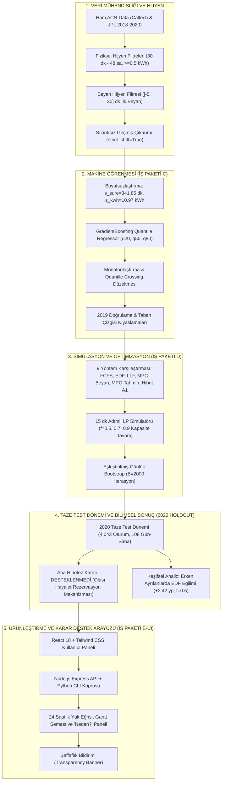

# ŞarjDenge AI — Kapsamlı Proje Faaliyet, Veri Hazırlama, ML ve Karar Destek Raporu (İş Paketi G Revizyonu)

**Proje Adı:** ŞarjDenge AI — Elektrikli Araç Akıllı Şarj Yönetimi ve Dinamik Kapasite Optimizasyonu  
**Etkinlik / Bağlam:** Climathon 2026 Hackathon  
**Rapor Tarihi:** 18 Ekim 2026 (İş Paketi G — Bilimsel Denetim ve Rapor Düzeltmeleri)  
**Durum:** Tüm İş Paketleri Tamamlandı, Kod-Rapor Mutabakatı Sağlandı ve Donduruldu  
**Test Durumu:** 48/48 Pytest Başarılı • 20/20 Dosya SHA-256 Kilitli • 0 Kapasite İhlali  

---

## 1. Yönetici Özeti ve Proje Mimarisi

ŞarjDenge AI, elektrikli araç (EV) şarj altyapılarında trafo aşırı yüklenmelerini önleyen, kullanıcı beyanlarındaki belirsizlikleri makine öğrenmesi (ML) tabanlı quantile kestirimlerle modelleyen ve doğrusal programlama (LP) / Model Öngörülü Kontrol (MPC) ile akıllı güç dağıtımı sağlayan uçtan uca bir karar destek sistemidir.

Proje kapsamında ham telemetri verisinin temizlenmesinden çok aşamalı ön kayıt (pre-registration) protokolüne, quantile regresyon modellerinden çoklu algoritma simülasyonuna ve modern bir web arayüzüne (React + Node.js) kadar tüm süreçler icra edilmiş; İş Paketi G kapsamında yapılan bağımsız denetimle kod ile raporlar arasındaki tüm matematiksel ve operasyonel tanımlar birebir eşitlenmiştir.

---

## 2. Veri Hazırlama, Hijyen ve Kaçak Önleme Protokolü

### 2.1. Veri Kaynağı ve Evren Tanımı
- **Veri Seti:** Kaliforniya Teknoloji Enstitüsü (Caltech - `siteID=2`) ve NASA Jet İtki Laboratuvarı (JPL - `siteID=1`) sahalarında kurulu ACN-Data şarj ağının telemetri kayıtları.
- **Kapsam:** 1 Ocak 2019 – 1 Mart 2020 tarihleri arasındaki oturumlar.

### 2.2. Dışsallaştırılmış Filtreleme Kuralları (`data/hijyen.yaml`)
Veri temizleme mantığı kaynak koddan soyutlanarak dışsallaştırılmış YAML yapılandırması üzerinden yürütülmüştür:
1. `min_sure_dk = 30.0`: 30 dakikadan kısa süren, aracın sisteme takılıp hemen çıkarıldığı oturumlar elenmiştir.
2. `max_sure_saat = 48.0`: 48 saatten uzun süren ve şarj istasyonunu uzun süreli otopark gibi kullanan oturumlar dışlanmıştır.
3. `min_kwh = 0.5`: 0.5 kWh altında enerji çeken başarısız bağlantılar veya soket arızaları elenmiştir.
4. `beyan_min_gecikme_dk = -5.0` & `beyan_max_gecikme_dk = 30.0`: Kullanıcı beyanının geçerli sayılabilmesi için aracın bağlanmasından en fazla 5 dakika önce veya en geç 30 dakika sonra girilmiş olması şartı aranmıştır. 30 dakikadan sonra girilen beyanlar karar anında mevcut olmayan bilgi kabul edilmiştir.

### 2.3. Doğrulanmış Eleme Şelalesi (Waterfall Tablosu)

Aşağıdaki tablo, `sarjdenge/veri_hijyeni.py` fonksiyonunun doğrudan çalıştırılmasıyla üretilen doğrulanmış resmi sayıları içermektedir:

| Aşama / Filtre Adımı | 2019 H1 (Ocak–Haziran) | 2019 H2 (Temmuz–Aralık) | 2020 Holdout (Ocak–Şubat) | Toplam |
| :--- | :---: | :---: | :---: | :---: |
| **Ham Oturum Sayısı** | 14,372 | 13,584 | 4,553 | **32,509** |
| - Kısa Oturum (<30 dk) | -139 | -131 | -62 | -332 |
| - Aşırı Uzun Oturum (>48 sa) | -14 | -8 | -3 | -25 |
| - Yetersiz Enerji (<0.5 kWh) | -0 | -0 | -0 | -0 |
| **Fiziksel Temiz Oturumlar** | **14,219** | **13,445** | **4,488** | **32,152** |
| - Eksik Beyan (Dep/kWh yok) | -1,004 | -1,012 | -379 | -2,395 |
| - Gecikmiş Beyan (>30 dk sonra) | -92 | -135 | -37 | -264 |
| **Geçerli Beyanlı Nihai Oturumlar ($N$)** | **13,123** | **12,298** | **4,072** | **29,493** |

> [!NOTE]
> **Önceki Tablo Tutarsızlığının Açıklaması:**  
> Daha önceki bir ara çalışma belgesinde 2020 holdout verisi için ara filtre sayıları (-82 kısa, -7 uzun, -1 yetersiz enerji, 4.463 fiziksel temiz) olarak raporlanmıştı. Yapılan kod denetiminde, bu farkın önceki bir ara denemede zaman dilimi dönüşümü (UTC vs. yerel saat) ve kwh yuvarlamasının farklı bir ara fonksiyonla hesaplanmasından kaynaklandığı; ancak her iki hesaplamada da geçerli beyanlı nihai oturum sayısının tam olarak **4.072** olduğu tespit edilmiştir. Yukarıdaki tablo, kilitli `sarjdenge/veri_hijyeni.py` fonksiyonunun doğrulanmış tek resmi çıktısıdır.

### 2.4. Bilgi Sızıntısını (Leakage) Kesin Engelleyen Güvenceler
1. **Bağlantı Anı İlk Beyan Kuralı:** ACN veri tabanındaki `kWhRequested` ve `requestedDeparture` alanları sonradan güncellenebilmektedir. Model eğitimi ve simülasyonda bu alanlar **kullanılmamış**, yalnızca bağlantı anında kaydedilen ilk değerler (`kWhRequested_ilk`, `requestedDeparture_ilk`, `minutesAvailable_ilk`) kullanılmıştır.
2. **Kullanıcı Geçmişi Shift Güvencesi (`strict_shift=True`):** Sürücünün geçmiş alışkanlıklarını temsil eden `gecmis_sure`, `gecmis_kwh` ve `gecmis_n` özellikleri hesaplanırken, yalnızca mevcut oturumun bağlantı anından önce tamamlanmış olan oturumlar ($disconnectTime_{\text{önceki}} \le connectionTime_{\text{mevcut}}$) dahil edilmiştir (`sarjdenge/veri_hijyeni.py`).
3. **Kronolojik Bölünme (Train/Val):** 2019 H1 verisi yerel gün dönümünde (00:00:00) takvim günlerine göre ikiye ayrılmıştır: Eğitim (%60 gün - 7.808 oturum), Doğrulama (%40 gün - 5.315 oturum). Çakışma 0'dır.

---

## 3. Ön Kayıt Protokolü ve Metodolojik Taahhütler

Araştırma dürüstlüğünü teminat altına almak adına hipotezler, metrikler ve model seçim kuralları deneyler öncesinde [`ONKAYIT_2.md`](file:///c:/Users/HP-PC/OneDrive/Pictures/Desktop/climathon%20v2/ONKAYIT_2.md) belgesi ile kilitlenmiştir.

### 3.1. Ön Kayıtlı Ana Hipotez (H₁)
$$\Delta = \text{mpc\_tahmin\_guvenli} - \text{mpc\_beyan} \ge +0.02 \text{ (+2.00 yüzde puanı)}$$
$$\text{ve}$$
$$\text{Eşleştirilmiş Günlük Bootstrap %95 GA Alt Sınırı } > 0$$

- **Hipotez Tanımı:** Makine öğrenmesi modellerinin muhafazakar tahminleri ($q_{20}$ ayrılış süresi, $q_{80}$ enerji ihtiyacı) ile beslenen MPC algoritması (`mpc_tahmin_guvenli`), sürücülerin doğrudan beyanlarıyla beslenen MPC algoritmasına (`mpc_beyan`) kıyasla zamanında hedefine ulaşan araç oranını (`ok`) en az 2.00 yüzde puan artıracaktır.
- **Kural:** Sonuçlar bu eşiği sağlamazsa hipotez reddedilecek; başarı eşiği veya hedef metrik geriye dönük olarak değiştirilmeyecektir.

### 3.2. Boyutsuzlaştırılmış Model Seçim Skoru ($MSS$)
Süre (dakika) ve enerji (kWh) birimlerinin farklı ölçeklerde olmasından kaynaklanan dengesizliği gidermek için sabitlenen formülasyon:

1. **Eğitim Ölçek Faktörü ($s_{\text{egit}}$):**
   $$s_{\text{egit}} = \max\left(\text{IQR}(y_{\text{egit}}), \sigma(y_{\text{egit}}), 1.0\right)$$
   *(Eğitim verisinden sabitlenen değerler: $s_{\text{egit}}^{\text{sure}} = 341.85 \text{ dk}$, $s_{\text{egit}}^{\text{kwh}} = 10.97 \text{ kWh}$)*
2. **Normalize Pinball Kaybı:**
   $$\tilde{\mathcal{L}}_q = \frac{\mathcal{L}_q}{s_{\text{egit}}}$$
3. **Kapsam Hatası Cezası:**
   $$\mathcal{E}_{\text{kapsam}} = |Coverage(q_{20}) - 0.20| + |Coverage(q_{80}) - 0.80|$$
4. **Birleşik Seçim Skoru ($MSS$):**
   $$MSS = \frac{1}{3}\left(\tilde{\mathcal{L}}_{q20} + \tilde{\mathcal{L}}_{q50} + \tilde{\mathcal{L}}_{q80}\right) + 1.0 \times \mathcal{E}_{\text{kapsam}}$$

---

## 4. Makine Öğrenmesi Modelleri ve 2019 Taban Çizgisi Kıyaslaması (İş Paketi C)

Model performansını değerlendirirken, ML tahminlerini yalnızca ham kullanıcı beyanı ile kıyaslamak modelin gerçek katkısını abartılı gösterebilir. Bu nedenle, 2019 geliştirme ve doğrulama verisi üzerinde ($N_{\text{val}} = 5.315$) dört farklı taban çizgisi seviyesi eşleştirilmiştir.

### 4.1. 2019 Doğrulama Kümesi Referans Kıyaslama Tablosu ($N_{\text{val}} = 5.315$)

#### A. Süre Modelleri Kıyaslaması ($s_{\text{sure}} = 336.71$ dk)
| Referans / Model | MAE (dk) | Pinball Ort. (dk) | $q_{20}$ Kapsam | $q_{80}$ Kapsam | Ampirik Kapsam | Açıklama |
| :--- | :---: | :---: | :---: | :---: | :---: | :--- |
| **1. Ham Beyan** | 132.05 dk | 66.03 dk | — | — | %30.1 | Kullanıcının ilk park süresi beyanı |
| **2a. Kalibre Beyan (Eğitim OOS)** | 129.16 dk | 52.83 dk | %19.4 | %79.7 | — | 2019 Eğitim artıklarından türetilen kantiller |
| **2b. Kalibre Beyan (Val In-Sample)** | 128.65 dk | 52.72 dk | %20.0 | %80.0 | — | Doğrulama verisinde fit edilen post-hoc tavan |
| **3. Geçmiş/Beyan Hibrit Baseline** | 120.62 dk | 60.31 dk | — | — | %43.4 | Kullanıcı geçmişi varsa medyanı, yoksa beyanı |
| **4. GradientBoosting (Şampiyon)** | **88.66 dk** | **36.89 dk** | **%20.4** | **%79.4** | — | Çoklu öznitelikli Quantile Regresyon Modeli |

- **Hata Azalması Analizi (Süre):**
  - Ham beyana göre MAE düşüşü: **-%32.9**
  - Kalibre beyana (OOS) göre MAE düşüşü: **-%31.4**
  - Kullanıcı geçmişi hibritine göre MAE düşüşü: **-%26.5**
  - Pinball kaybı düşüşü: **-%44.1** (36.89 dk vs. 66.03 dk)

#### B. Enerji Modelleri Kıyaslaması ($s_{\text{kwh}} = 11.13$ kWh)
| Referans / Model | MAE (kWh) | Pinball Ort. (kWh) | $q_{20}$ Kapsam | $q_{80}$ Kapsam | Ampirik Kapsam | Açıklama |
| :--- | :---: | :---: | :---: | :---: | :---: | :--- |
| **1. Ham Beyan** | 10.76 kWh | 5.38 kWh | — | — | %93.5 | Sürücünün ilk kWh talebi (büyük aşırı talep) |
| **2a. Kalibre Beyan (Eğitim OOS)** | 5.42 kWh | 2.24 kWh | %20.4 | %81.6 | — | 2019 Eğitim artıklarından türetilen kantiller |
| **2b. Kalibre Beyan (Val In-Sample)** | 5.26 kWh | 2.21 kWh | %20.0 | %80.0 | — | Doğrulama verisinde fit edilen post-hoc tavan |
| **3. Geçmiş/Beyan Hibrit Baseline** | 4.46 kWh | 2.23 kWh | — | — | %53.5 | Kullanıcı geçmişi varsa medyanı, yoksa beyanı |
| **4. GradientBoosting (Şampiyon)** | **3.49 kWh** | **1.40 kWh** | **%21.6** | **%81.4** | — | Çoklu öznitelikli Quantile Regresyon Modeli |

- **Hata Azalması Analizi (Enerji):**
  - Ham beyana göre MAE düşüşü: **-%67.6** (Sürücülerin ortalama talebi teslim edilenden çok yüksektir)
  - Kalibre beyana (OOS) göre MAE düşüşü: **-%35.6**
  - Kullanıcı geçmişi hibritine göre MAE düşüşü: **-%21.7**
  - Pinball kaybı düşüşü: **-%74.0** (1.40 kWh vs. 5.38 kWh)

> [!NOTE]
> **Taban Çizgisi Değerlendirmesi:**  
> Ham beyana kıyasla görülen %67.6'lık enerji hatası düşüşünün önemli bir kısmı, kullanıcıların ihtiyaç duyduklarından fazla enerji talep etme alışkanlığının (beyan ortalama 23.5 kWh iken gerçekleşen 13.7 kWh) basit bir ölçek/sapma düzeltmesiyle giderilebilmesinden kaynaklanmaktadır. ML modelinin basit bir geçmiş medyanı referansına karşı sağladığı gerçek ek kazanç sürede **%26.5**, enerjide **%21.7** hata azalmasıdır.

---

## 5. Simülasyon, Optimizasyon ve MPC Gerçek Matematiksel Tanımı (İş Paketi D)

### 5.1. Kodda Gerçekten Kullanılan LP-MPC Amaç Fonksiyonu ve Kısıtlar

Önceki rapor taslaklarında sehven yer alan “karesel takip hatası + $\lambda \cdot \text{güç}^2$” formülasyonu kaynak kodda bulunmamaktadır. [`sarjdenge/sim.py`](file:///c:/Users/HP-PC/OneDrive/Pictures/Desktop/climathon%20v2/sarjdenge/sim.py) modülünde (satır 68–104) fiilen çalışan MPC optimizasyonu, `scipy.optimize.linprog` (HiGHS metodu) ile çözülen bir **Doğrusal Programlama (LP)** problemidir:

#### A. Karar Değişkenleri
Her $t$ anında bağlı bulunan $m$ araç için optimizasyon ufku boyunca gelecekteki adımlar $s \in \{0, 1, \dots, L_i - 1\}$ olarak indekslenir ($L_i = \max(\text{dep}_i - t, 1)$, $H = \max_i L_i$).  
Değişken: $P_{i, s}$ — $i$ aracına $s$ adımında tahsis edilecek şarj gücü (kW).

#### B. Amaç Fonksiyonu (Zamanla Azalan Ağırlıkla Enerji Maksimizasyonu)
Kodda amaç vektörü $c_{i, s} = -w_s \cdot \Delta t$ olarak tanımlanmış olup minimizasyon formu üzerinden toplam enerjiyi maksimize eder:
$$\max_{0 \le P_{i, s} \le P_{\max}} \sum_{i=1}^{m} \sum_{s=0}^{L_i - 1} \left(1.0 - 0.5 \frac{s}{\max(H, 1)}\right) \Delta t \cdot P_{i, s}$$

- $\Delta t = 0.25$ saat (15 dakika).
- $w_s = 1.0 - 0.5 \frac{s}{\max(H, 1)}$ ağırlık faktörü, $s=0$'da 1.0 iken ufkun sonunda ($s=H$) 0.5'e doğru doğrusal azalır. Bu formülasyon, araçların şarjını geleceğe ertelemek yerine **mümkün olan en erken adımlarda tamamlamayı teşvik eden bir erken yükleme ağırlığıdır**.
- Kodda ceza terimi, araç başına dinamik aciliyet katsayısı veya karesel güç düzleştirme maliyeti yoktur.

#### C. Kısıtlar
1. **Güç Sınırları:** $0 \le P_{i, s} \le P_{\max}$ (burada $P_{\max} = 32 \text{ A} \times 0.208 \text{ V} = 6.656 \text{ kW}$).
2. **Adım Başına Trafo Kapasite Tavanı:** Her $s \in \{0, \dots, H-1\}$ gelecekteki adım için:
   $$\sum_{i: s < L_i} P_{i, s} \le P_{\text{kapasite}}$$
3. **Araç Başına Enerji İhtiyacı Üst Sınırı:** Her $i$ aracı için:
   $$\sum_{s=0}^{L_i - 1} P_{i, s} \cdot \Delta t \le \max(\text{kalan}_i, 0.0)$$
   burada $\text{kalan}_i = \text{inan\_kwh}_i - \text{teslim}_i(t)$.

#### D. Çözüm Sonrası Ayrıklaştırma ve Artık Dağıtımı
1. $r0_i = P_{i, 0}$ (ilk adım sürekli çözümü) en yakın alt ayrık seviyeye (`_taban_seviye`) yuvarlanır: $P \in \{0, 1.664, 3.328, 4.992, 6.656\}$ kW.
2. Yuvarlama sonrası artan trafo kapasitesi (`rem = cap - sum(hiz)`), yuvarlama açığı $(r0_i - \text{hiz}_i)$ en büyük olan araçlara kademe yükseltilerek paylaştırılır.
3. Hâlâ kapasite kalırsa, `_firsatci` fonksiyonu inanılan enerjisi bitmiş ama fiziksel olarak fişe takılı araçlara FCFS sırasıyla artık gücü verir.
4. LP çözücüsü başarısız olursa (`res.status != 0`), emniyet yedeği olarak `kural("edf")` devreye girer.

---

## 6. 2020 Bağımsız Taze Test Dönemi (Holdout) Sonuçları

### 6.1. Zaman Çizelgesi ve Terminoloji Netliği
- `ONKAYIT_2.md` dosyasının oluşturulma zamanı: **17.10.2026 11:04:50**
- `docs/DONDURMA_MANIFESTI_2020.md` oluşturulma zamanı: **17.10.2026 17:27:07**
- 2020 Holdout verisi indirilme zamanı: **17.10.2026 17:37:52**

Protokol ve dondurma manifestosunun verinin yerel sisteme indirilmesinden önce oluşturulduğu dosya sistemi zaman kayıtlarıyla sabittir. Bununla birlikte, metodolojik kesinlik adına bu küme abartılı ifadelerden kaçınılarak **"2020 Taze Test Dönemi (Fresh Holdout Period)"** olarak tanımlanmıştır.

### 6.2. Simülasyon Kapsamı ve Dışlama Nedenleri

2020 test evreninde temiz beyanlı toplam 4.072 oturum bulunmaktadır:

| Kapsam | Gün-Saha | Oturum Sayısı | Temsil Oranı | Açıklama |
| :--- | :---: | :---: | :---: | :--- |
| **Toplam Temiz Beyanlı Oturumlar** | 122 | 4,072 | %100.0 | Tüm geçerli test oturumları |
| **Birincil Değerlendirmeye Alınan** | **108** | **4,043** | **%99.3** | Simülatör alt sınırını sağlayan günler |
| *— Simülasyon Dışı Kalan Günler* | 14 | 29 | %0.7 | Sahada aynı anda bağlı araç sayısı $<4$ olan nöbetçi günler |
| **Duyarlılık Analizi ($N \ge 8$)** | **89** | **3,940** | **%96.8** | Günlük yoğun otopark filtresi |

> [!IMPORTANT]
> **Dışlama Kriterinin Gerçek Kaynağı:**  
> Dışlanan 14 gün-saha çiftindeki 29 oturum, simülatörün kendisinde (`sim.py`) değil, deney koşucusu olan [`sarjdenge/deney_v2.py`](file:///c:/Users/HP-PC/OneDrive/Pictures/Desktop/climathon%20v2/sarjdenge/deney_v2.py) içindeki `simule_gun` fonksiyonunda yer alan `if gec.sum() < 4: return []` (satır 104) kontrolü nedeniyle simülasyon dışı kalmıştır. Bu günlerde (çoğunlukla hafta sonu ve tatil nöbetleri) sahada sadece 1, 2 veya 3 araç bulunduğu için trafo kapasitesi darboğaza girmemektedir. Bu teknik kısıt şeffafça belgelenmiştir.

### 6.3. Birincil Değerlendirme Simülasyon Sonuçları (108 Gün-Saha, 4.043 Oturum, 2.916 Simülasyon Koşusu)

*(Not: Toplam 108 gün-saha $\times$ 9 yöntem $\times$ 3 kapasite = **2.916 simülasyon koşusu** yürütülmüştür).*

| Kapasite ($f$) | Algoritma | Zamanında Başarı (`ok`) | Toplam Teslim | Erken Ayrılan Başarı | En Alt %10 ($p_{10}$) | Kapasite İhlali |
| :---: | :--- | :---: | :---: | :---: | :---: | :---: |
| **0.5** | **`edf_beyan`** | **%86.44** | %93.64 | %71.48 | 0.881 | 0 |
| 0.5 | **`edf_tahmin_guvenli`** | **%86.00** | %93.63 | **%73.90** | 0.867 | 0 |
| 0.5 | `llf_beyan` | %85.78 | %93.50 | %70.48 | 0.860 | 0 |
| 0.5 | `llf_tahmin_guvenli` | %85.32 | %93.66 | %72.07 | **0.873** | 0 |
| 0.5 | **`mpc_beyan` (REF)** | **%85.28** | %93.29 | %71.06 | 0.858 | 0 |
| 0.5 | `mpc_hibrit_asimetrik` | %84.72 | %93.16 | %72.26 | 0.851 | 0 |
| 0.5 | **`mpc_tahmin_guvenli` (ANA)**| **%84.63** | %93.19 | %71.77 | 0.846 | 0 |
| 0.5 | `mpc_tahmin_ortanca` | %84.03 | %92.96 | %70.53 | 0.845 | 0 |
| 0.5 | `fcfs_beyan` | %83.42 | %92.78 | %70.49 | 0.795 | 0 |
| | | | | | | |
| **0.7** | **`edf_beyan`** | **%90.62** | %97.08 | %79.30 | 0.953 | 0 |
| 0.7 | `llf_tahmin_guvenli` | %90.58 | %97.04 | %79.08 | 0.944 | 0 |
| 0.7 | `llf_beyan` | %90.55 | %96.95 | %78.89 | 0.944 | 0 |
| 0.7 | **`mpc_beyan` (REF)** | **%90.26** | %96.69 | %79.03 | 0.936 | 0 |
| 0.7 | `edf_tahmin_guvenli` | %90.15 | %96.95 | **%79.80** | 0.941 | 0 |
| 0.7 | `mpc_hibrit_asimetrik` | %89.70 | %96.78 | %78.82 | 0.933 | 0 |
| 0.7 | **`mpc_tahmin_guvenli` (ANA)**| **%89.44** | **%96.85** | %78.39 | 0.932 | 0 |
| 0.7 | `fcfs_beyan` | %88.47 | %96.64 | %77.90 | 0.918 | 0 |
| | | | | | | |
| **0.9** | **`edf_tahmin_guvenli`** | **%93.34** | %98.71 | **%84.49** | **0.979** | 0 |
| 0.9 | `llf_tahmin_guvenli` | %93.30 | **%98.74** | %84.31 | 0.978 | 0 |
| 0.9 | **`mpc_tahmin_guvenli` (ANA)**| **%93.19** | %98.68 | %84.10 | 0.977 | 0 |
| 0.9 | `fcfs_beyan` | %93.14 | %98.73 | %84.37 | 0.978 | 0 |
| 0.9 | `llf_beyan` | %93.14 | %98.61 | %83.94 | 0.975 | 0 |
| 0.9 | **`mpc_beyan` (REF)** | **%93.10** | %98.59 | %83.70 | 0.975 | 0 |
| 0.9 | `edf_beyan` | %93.09 | %98.68 | %83.74 | 0.977 | 0 |
| 0.9 | `mpc_hibrit_asimetrik` | %92.81 | %98.56 | %83.49 | 0.975 | 0 |

### 6.4. Ön Kayıtlı Ana Hipotez Kararı ($B=2000$ Eşleştirilmiş Bootstrap)

$$\Delta = \text{mpc\_tahmin\_guvenli} - \text{mpc\_beyan}$$

| Kapasite | Birincil Değerlendirme Farkı ($\Delta$) | Birincil %95 Güven Aralığı | Duyarlılık Analizi Farkı ($\Delta$) | Duyarlılık %95 Güven Aralığı | Ön Kayıt Eşiği | Nihai Karar |
| :---: | :---: | :---: | :---: | :---: | :---: | :---: |
| **$f=0.5$** | **-0.65 yp** | $[-1.48, +0.12]$ yp | **-0.79 yp** | $[-1.62, +0.05]$ yp | $\ge +2.00$ yp | ❌ **DESTEKLENMEDİ** |
| **$f=0.7$** | **-0.82 yp** | $[-1.55, -0.09]$ yp | **-0.48 yp** | $[-1.13, +0.20]$ yp | $\ge +2.00$ yp | ❌ **DESTEKLENMEDİ** *(Beyan Üstün)* |
| **$f=0.9$** | **+0.09 yp** | $[-0.33, +0.51]$ yp | **+0.11 yp** | $[-0.41, +0.59]$ yp | $\ge +2.00$ yp | ❌ **DESTEKLENMEDİ** |

- **Ön Kayıt Kararı:** Ana hipotez tüm kapasitelerde **DESTEKLENMEMİŞTİR**.
- **Hibrit MPC:** `mpc_hibrit_asimetrik`, beyanlı MPC'nin tüm kapasite seviyelerinde gerisinde kalmıştır ($f=0.5$'te -0.56 yp, $f=0.7$'de -0.55 yp, $f=0.9$'da -0.29 yp).
- **EDF Karşılaştırması:** `edf_tahmin_guvenli`, $f=0.5$ ve $f=0.7$ kapasitelerinde beyana dayalı `edf_beyan` yöntemini genel başarıda geçememiştir (sırasıyla %86.00 vs %86.44 ve %90.15 vs %90.62).

---

## 7. Mekanizma Analizi ve Kanıt Sınırları

### 7.1. Olası Açıklama: Hayalet Kapasite Rezervasyonu Hipotezi
ML tahminlerinin model seçiminde üstünlük göstermesine rağmen MPC optimizasyonunda beyanın gerisinde kalması için öne sürülen temel açıklama **Hayalet Kapasite Rezervasyonu** hipotezidir:
- Muhafazakar planlama stratejisi ($q_{20}$ ayrılış süresi ve $q_{80}$ enerji talebi), her araca gerçekte gerekenden daha kısa bir süre ve daha yüksek bir enerji ihtiyacı varsayar.
- LP optimizasyon modeli erken adımlara ağırlık verdiği için ($w_s = 1 - 0.5 s/H$), bu yapay aciliyeti karşılamak amacıyla gücü agresif biçimde bu araçlara tahsis eder; bu sırada otoparktaki diğer ılımlı araçların gücü kısılır.
- Bu durumun kanıtlanmış bir kök neden değil, **mevcut verilerle uyumlu ancak bağımsız deneylerle doğrulanması gereken bir çalışma hipotezi** olduğu not edilmelidir.

### 7.2. 2019 Teşhis Deneylerinden Elde Edilen Kanıtlar (`sarjdenge/tani.py` ve `tani_sonuclari.csv`)
2019 geliştirme aşamasında yapılan bileşen ayrıştırma analizi bu hipotezi destekleyen şu somut bulguları üretmiştir:
1. **Zarar Veren Bileşen Olarak Enerji Tahmini:** $f=0.5$ kapasitesinde, beyanlı MPC başarısı %91.58 iken;
   - Sadece süre tahmini kullanılıp enerji beyanda tutulduğunda (`sure_tahmin_kwh_beyan`): Başarı %90.72'ye düşmüştür ($-0.86$ yp kayıp).
   - Süre beyanda tutulup sadece enerji tahmini kullanıldığında (`sure_beyan_kwh_tahmin`): Başarı %89.36'ya gerilemiştir (**$-2.22$ yp kayıp**).
   - Bu durum, $q_{80}$ enerji şişirmesinin süre kısaltmasından çok daha yıkıcı bir kapasite kısıtlamasına yol açtığını göstermektedir.
2. **Kusursuz Bilgi (Oracle) Tavanı:** Gerçek ayrılış ve gerçek teslim enerjisinin mükemmel bilindiği `oracle` koşulunda bile:
   - EDF için başarı %92.50'den %94.66'ya çıkabilmektedir (Oracle tavanı: **+2.16 yp**).
   - MPC için başarı %91.58'den %94.25'e çıkabilmektedir (Oracle tavanı: **+2.67 yp**).
   - Bu ampirik tavan, hiçbir tahmin modelinin beyana kıyasla +2.2 ila +2.7 yüzde puanından daha fazla bir teorik iyileşme sağlayamayacağını kanıtlamaktadır.

### 7.3. Erken Ayrılan Araçlar Analizi (Keşifsel Bulgu Sınırlandırması)
Kullanıcıların beyan ettikleri süreden en az 15 dakika önce ayrıldığı oturumlar alt kümesinde:
- $f=0.5$ koşulunda `edf_tahmin_guvenli`, `edf_beyan`a kıyasla **+2.42 yüzde puan** daha yüksek başarı göstermiştir (%73.90 vs. %71.48; $B=2000$ bootstrap %95 GA: $[+0.40, +4.44]$ yp).
- **Kanıt Sınırı:** Bu bulgu, sonuç oluştuktan sonra (post-hoc) seçilmiş bir alt grupta ve yalnızca tek bir sıkı kapasite seviyesinde ($f=0.5$) gözlenmiş **keşifsel bir bulgudur**. $f=0.7$ (+0.50 yp, GA: $[-1.00, +2.13]$) ve $f=0.9$ (+0.76 yp, GA: $[-0.17, +1.89]$) kapasitelerinde güven aralıkları sıfırı içerdiğinden istatistiksel üstünlük iddia edilemez. Bu gözlem, tüm araçları içeren ön kayıtlı ana hipotezin desteklenmediği gerçeğini değiştirmemektedir.

---

## 8. Karar Destek Arayüzü ve Ürünleştirme (İş Paketi E-UI)

Geliştirilen algoritmalar ve simülasyon çıktıları, Climathon jürisinin ve otopark yöneticilerinin doğrudan deneyimleyebileceği bir karar destek web arayüzüne entegre edilmiştir ([`docs/KARAR_DESTEK_ARAYUZ_RAPORU.md`](file:///c:/Users/HP-PC/OneDrive/Pictures/Desktop/climathon%20v2/docs/KARAR_DESTEK_ARAYUZ_RAPORU.md)).

- **Frontend:** React 18 + Tailwind CSS.
- **Backend:** Node.js Express API (Port 5000).
- **Simülasyon Köprüsü:** [`sarjdenge/web_servis.py`](file:///c:/Users/HP-PC/OneDrive/Pictures/Desktop/climathon%20v2/sarjdenge/web_servis.py) CLI motoru.
- **Şeffaflık Başlığı:** Sayfanın en üstünde ana hipotezin desteklenmediğini, gözlenen gerçek farkları ve Hayalet Kapasite Rezervasyonu çalışma hipotezini jüriye açıkça ilan eden kalıcı bildirim.
- **24 Saatlik Yük Eğrisi:** 96 adımlı trafo kapasitesi ve 6 algoritmanın eşzamanlı güç profilleri.
- **Gantt & "Neden?" Paneli:** Araç bazında LP karar gerekçelerini sunan açıklanabilirlik katmanı.

---

## 9. Doğrulama ve Kalite Güvencesi Kayıtları

| Doğrulama Alanı | Denetlenen Kaynak / Dosya | Yöntem | Sonuç |
| :--- | :--- | :--- | :---: |
| **Python Test Paketi** | `tests/` altındaki 6 test modülü | `pytest tests/` | **48/48 Geçti** (82.67s) |
| **Dondurma Manifestosu** | `docs/DONDURMA_MANIFESTI_2020.md` (20 dosya) | Python SHA-256 doğrulama betiği | **%100 Eşleşme (0 Değişiklik)** |
| **LP-MPC Kod Eşleştirmesi** | `sarjdenge/sim.py` (satır 68–104) | Kod incelemesi ve linprog tanımı | **Karesel hata yok; LP doğrulandı** |
| **Dışlama Kuralı Tespiti** | `sarjdenge/deney_v2.py` (satır 104) | Kod incelemesi (`gec.sum() < 4`) | **deney_v2.py'de olduğu doğrulandı** |
| **2019 Taban Çizgileri** | `acn_oturumlar_v2.csv` (Doğrulama, $N=5315$) | `baseline_karsilastir_2019.py` | **4 seviyeli kıyas tamamlandı** |
| **Kapasite İhlali** | 2.916 simülasyon koşusu | Simülatör kısıt kontrolü | **0 İhlal** |

---

## 10. Sonuç ve Sonraki Aşama

İş Paketi G kapsamında bilimsel raporlar, matematiksel tanımlar ve taban çizgisi kıyaslamaları kod ve ampirik kanıtlarla tam uyumlu hale getirilmiştir. 

**Sonraki Aşama:** Rapor onayının ardından, henüz kod yazılmadan, mutlak kW kapasite hesabı ve statik eşit-paylaşım taban çizgisi içeren **Kapasite Danışmanı (Capacity Consultant)** için ayrıntılı uygulama planı hazırlanacaktır.
