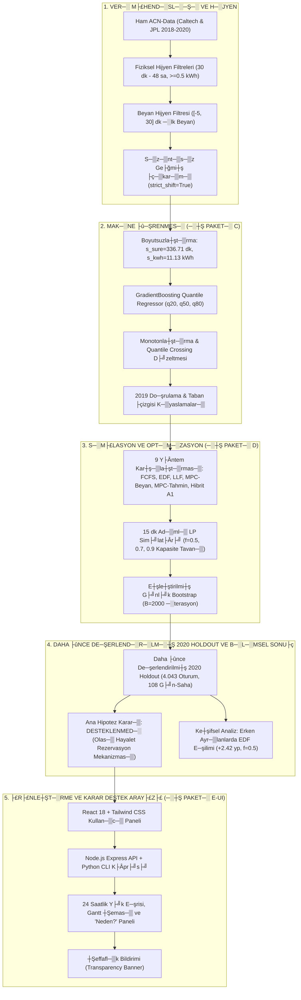

# ┼ŞarjDenge AI ÔÇö Kapsaml─▒ Proje Faaliyet, Veri Haz─▒rlama, ML ve Karar Destek Raporu (─░┼ş Paketi G Revizyonu)

**Proje Ad─▒:** ┼ŞarjDenge AI ÔÇö Elektrikli Ara├ğ Ak─▒ll─▒ ┼Şarj Y├Ânetimi ve Dinamik Kapasite Optimizasyonu
**Etkinlik / Ba─şlam:** Climathon 2026 Hackathon
**Rapor Tarihi:** 18 Ekim 2026 (─░┼ş Paketi G ÔÇö Bilimsel Denetim ve Rapor D├╝zeltmeleri)
**Durum:** T├╝m ─░┼ş Paketleri Tamamland─▒, Kod-Rapor Mutabakat─▒ Sa─şland─▒ ve Donduruldu
**Test Durumu:** 56/56 Pytest Ba┼şar─▒l─▒ ÔÇó 20/20 Dosya SHA-256 Kilitli ÔÇó 0 Kapasite ─░hlali

---

## 1. Y├Ânetici ├ûzeti ve Proje Mimarisi

┼ŞarjDenge AI, elektrikli ara├ğ (EV) ┼şarj altyap─▒lar─▒nda trafo a┼ş─▒r─▒ y├╝klenmelerini ├Ânleyen, kullan─▒c─▒ beyanlar─▒ndaki belirsizlikleri makine ├Â─şrenmesi (ML) tabanl─▒ quantile kestirimlerle modelleyen ve do─şrusal programlama (LP) / Model ├ûng├Âr├╝l├╝ Kontrol (MPC) ile ak─▒ll─▒ g├╝├ğ da─ş─▒t─▒m─▒ sa─şlayan u├ğtan uca bir karar destek sistemidir.

Proje kapsam─▒nda ham telemetri verisinin temizlenmesinden ├ğok a┼şamal─▒ ├Ân kay─▒t (pre-registration) protokol├╝ne, quantile regresyon modellerinden ├ğoklu algoritma sim├╝lasyonuna ve modern bir web aray├╝z├╝ne (React + Node.js) kadar t├╝m s├╝re├ğler icra edilmi┼ş; ba─ş─▒ms─▒z denetimle kod ile raporlar aras─▒ndaki t├╝m matematiksel ve operasyonel tan─▒mlar do─şrulanm─▒┼şt─▒r.

> [!IMPORTANT]
> **Ön Kayıtlı Ana Hipotez Durumu:**
> ├ûnceden kaydedilen ana hipotez (`mpc_tahmin_guvenli - mpc_beyan >= +0.02` ve %95 GA alt s─▒n─▒r─▒ > 0), ne 2019 do─şrulama d├Âneminde ne de daha ├Ânce de─şerlendirilmi┼ş 2020 holdout d├Âneminde **desteklenmemi┼ş; s─▒f─▒r hipotezi reddedilememi┼ştir**. Makine ├Â─şrenmesi modelleri kullan─▒c─▒ beyan─▒na k─▒yasla s├╝re ve enerji mutlak hatalar─▒n─▒ belirgin bi├ğimde d├╝┼ş├╝rm├╝┼ş ve quantile kalibrasyonu sa─şlam─▒┼ş olsa da; saf enerji-LP tabanl─▒ MPC mimarisinde bu do─şruluk zaman─▒nda tamamlanan ara├ğ say─▒s─▒na pozitif yans─▒mam─▒┼ş, dar ve orta kapasitelerde kullan─▒c─▒ beyan─▒na dayal─▒ y├Ântemlerin (├Âzellikle `edf_beyan`) gerisinde kalm─▒┼şt─▒r. Sonu├ğlar hi├ğbir a┼şamada ba┼şar─▒ gibi yeniden yorumlanmam─▒┼ş, do─şrudan ve ┼şeffaf bi├ğimde raporlanm─▒┼şt─▒r.

---

## 2. Veri Haz─▒rlama, Hijyen ve Ka├ğak ├ûnleme Protokol├╝

### 2.1. Veri Kayna─ş─▒, Evren Tan─▒m─▒ ve Bilimsel S─▒n─▒rlar
- **Veri Seti:** Kaliforniya Teknoloji Enstit├╝s├╝ (Caltech - `siteID=2`) ve NASA Jet ─░tki Laboratuvar─▒ (JPL - `siteID=1`) sahalar─▒nda kurulu ACN-Data ┼şarj a─ş─▒n─▒n telemetri kay─▒tlar─▒.
- **Kapsam:** 1 Ocak 2019 ÔÇô 1 Mart 2020 tarihleri aras─▒ndaki oturumlar.
- **`kWhDelivered` S─▒n─▒rland─▒rmas─▒:** ACN verisindeki `kWhDelivered` alan─▒ arac─▒n ger├ğek toplam batarya kapasitesini veya toplam ihtiyac─▒n─▒ de─şil, oturumda EVSE taraf─▒ndan teslim edilen enerji miktar─▒n─▒ (tarihsel teslim enerjisi / talep g├Âstergesi) temsil eder.
- **T├╝rkiye Apartman Senaryosu:** `sarjdenge/turkiye.py`, `sentetik.py` ve `sentetik_v2.py` mod├╝llerindeki profiller **kesinlikle ger├ğek saha telemetrisi de─şildir; kod tabanl─▒ sentetik senaryolard─▒r**.
- **2020 Verisi:** 2020 d├Ânemi verisi daha ├Ânce indirilmi┼ş ve incelenmi┼ştir; gelecekteki model se├ğimi i├ğin dokunulmam─▒┼ş test seti olarak adland─▒r─▒lamaz.

### 2.2. D─▒┼şsalla┼şt─▒r─▒lm─▒┼ş Filtreleme Kurallar─▒ (`data/hijyen.yaml`)
Veri temizleme mant─▒─ş─▒ kaynak koddan soyutlanarak d─▒┼şsalla┼şt─▒r─▒lm─▒┼ş YAML yap─▒land─▒rmas─▒ ├╝zerinden y├╝r├╝t├╝lm├╝┼şt├╝r:
1. `min_sure_dk = 30.0`: 30 dakikadan k─▒sa s├╝ren, arac─▒n sisteme tak─▒l─▒p hemen ├ğ─▒kar─▒ld─▒─ş─▒ oturumlar elenmi┼ştir.
2. `max_sure_saat = 48.0`: 48 saatten uzun s├╝ren ve ┼şarj istasyonunu uzun s├╝reli otopark gibi kullanan oturumlar d─▒┼şlanm─▒┼şt─▒r.
3. `min_kwh = 0.5`: 0.5 kWh alt─▒nda enerji ├ğeken ba┼şar─▒s─▒z ba─şlant─▒lar veya soket ar─▒zalar─▒ elenmi┼ştir.
4. `beyan_min_gecikme_dk = -5.0` & `beyan_max_gecikme_dk = 30.0`: Kullan─▒c─▒ beyan─▒n─▒n ge├ğerli say─▒labilmesi i├ğin arac─▒n ba─şlanmas─▒ndan en fazla 5 dakika ├Ânce veya en ge├ğ 30 dakika sonra girilmi┼ş olmas─▒ ┼şart─▒ aranm─▒┼şt─▒r. 30 dakikadan sonra girilen beyanlar karar an─▒nda mevcut olmayan bilgi kabul edilmi┼ştir.

### 2.3. Do─şrulanm─▒┼ş Eleme ┼Şelalesi (Waterfall Tablosu)

A┼şa─ş─▒daki tablo, `sarjdenge/veri_hijyeni.py` fonksiyonunun do─şrudan ├ğal─▒┼şt─▒r─▒lmas─▒yla ├╝retilen do─şrulanm─▒┼ş resmi say─▒lar─▒ i├ğermektedir:

| A┼şama / Filtre Ad─▒m─▒ | 2019 H1 (OcakÔÇôHaziran) | 2019 H2 (TemmuzÔÇôAral─▒k) | 2020 Holdout (OcakÔÇô┼Şubat) | Toplam |
| :--- | :---: | :---: | :---: | :---: |
| **Ham Oturum Say─▒s─▒** | 14,372 | 13,584 | 4,553 | **32,509** |
| - K─▒sa Oturum (<30 dk) | -139 | -131 | -62 | -332 |
| - A┼ş─▒r─▒ Uzun Oturum (>48 sa) | -14 | -8 | -3 | -25 |
| - Yetersiz Enerji (<0.5 kWh) | -0 | -0 | -0 | -0 |
| **Fiziksel Temiz Oturumlar** | **14,219** | **13,445** | **4,488** | **32,152** |
| - Eksik Beyan (Dep/kWh yok) | -1,004 | -1,012 | -379 | -2,395 |
| - Gecikmi┼ş Beyan (>30 dk sonra) | -92 | -135 | -37 | -264 |
| **Ge├ğerli Beyanl─▒ Nihai Oturumlar ($N$)** | **13,123** | **12,298** | **4,072** | **29,493** |

> [!NOTE]
> **Ham Dosya ve Filtrelenmi┼ş Oturum Say─▒lar─▒ Kesin Mutabakat─▒:**
> - **2019 H1 K├╝mesi:** `acn_20181231_20190630.csv` dosyas─▒ 1 ba┼şl─▒k sat─▒r─▒ ve **14.372 ham veri sat─▒r─▒** (toplam 14.373 sat─▒r) i├ğermektedir. Baz─▒ eski ├Âzetlerde ge├ğen 14.219 say─▒s─▒ ham sat─▒r say─▒s─▒ de─şil, `sarjdenge/veri_hijyeni.py` taraf─▒ndan s├╝re ve enerji s─▒n─▒rlar─▒ uygulanm─▒┼ş **fiziksel temiz oturum say─▒s─▒d─▒r**. Beyan filtresi sonras─▒ nihai ge├ğerli oturum say─▒s─▒ **13.123**'t├╝r (7.808 e─şitim + 5.315 do─şrulama; `min_arac_gunluk=8` sim├╝lasyon filtresi sonras─▒ 5.207 oturum).
> - **2020 Holdout K├╝mesi ve D─▒┼şlama Say─▒lar─▒ (`62/3/0` vs `82/7/1`):** `acn_holdout_20200101_20200301_ham.csv` dosyas─▒ 1 ba┼şl─▒k sat─▒r─▒ ve **4.553 ham veri sat─▒r─▒** (1.670 Caltech + 2.883 JPL, toplam 4.554 sat─▒r) i├ğermektedir. Kilitli `sarjdenge/veri_hijyeni.py:eleme_selalesi()` ve `sarjdenge/data.py:yukle()` fonksiyonlar─▒ bu dosya ├╝zerinde deterministik olarak **-62 k─▒sa oturum (<30 dk), -3 a┼ş─▒r─▒ uzun oturum (>48 sa) ve -0 yetersiz enerji (<0.5 kWh)** eleyerek **4.488 fiziksel temiz oturum**; ard─▒ndan -379 eksik beyan ve -37 gecikmi┼ş beyan filtresiyle **4.072 ge├ğerli beyanl─▒ nihai oturum** ├╝retmektedir. Eski bir ara taslakta ge├ğen `-82 k─▒sa, -7 uzun, -1 yetersiz enerji (4.463 temiz)` say─▒lar─▒ depodaki kilitli ham CSV/JSON dosyalar─▒ndan veya mevcut kod ak─▒┼ş─▒ndan yeniden ├╝retilememektedir; bu nedenle do─şrulanm─▒┼ş `62/3/0` ┼şelalesiyle tek bir say─▒ alt─▒nda birle┼ştirilmemi┼ştir. ├ûnceki bir d├Âk├╝mde sehven yer alan 2.417 say─▒s─▒ ise ham sat─▒r say─▒s─▒ de─şil, holdout g├╝nl├╝k sonu├ğ tablosundaki bir alt transkripsiyondur.
> - **2021 ─░leriye D├Ân├╝k Deney S─▒n─▒r─▒:** ACN-Data portal─▒na harici eri┼şim sorunu nedeniyle 2021 ileriye d├Ân├╝k veri envanteri ve deneyi uygulanamam─▒┼ş olup g├╝ncel teknik s─▒n─▒r olarak kaydedilmi┼ştir.

### 2.4. Bilgi S─▒z─▒nt─▒s─▒n─▒ (Leakage) Kesin Engelleyen G├╝venceler
1. **Ba─şlant─▒ An─▒ ─░lk Beyan Kural─▒:** ACN veri taban─▒ndaki `kWhRequested` ve `requestedDeparture` alanlar─▒ sonradan g├╝ncellenebilmektedir. Model e─şitimi ve sim├╝lasyonda bu alanlar **kullan─▒lmam─▒┼ş**, yaln─▒zca ba─şlant─▒ an─▒nda kaydedilen ilk de─şerler (`kWhRequested_ilk`, `requestedDeparture_ilk`, `minutesAvailable_ilk`) kullan─▒lm─▒┼şt─▒r.
2. **Kullan─▒c─▒ Ge├ğmi┼şi Shift G├╝vencesi (`strict_shift=True`):** S├╝r├╝c├╝n├╝n ge├ğmi┼ş al─▒┼şkanl─▒klar─▒n─▒ temsil eden `gecmis_sure`, `gecmis_kwh` ve `gecmis_n` ├Âzellikleri hesaplan─▒rken, yaln─▒zca mevcut oturumun ba─şlant─▒ an─▒ndan ├Ânce tamamlanm─▒┼ş olan oturumlar ($disconnectTime_{\text{├Ânceki}} \le connectionTime_{\text{mevcut}}$) dahil edilmi┼ştir (`sarjdenge/veri_hijyeni.py`).
3. **Kronolojik B├Âl├╝nme (Train/Val):** 2019 H1 verisi yerel g├╝n d├Ân├╝m├╝nde (00:00:00) takvim g├╝nlerine g├Âre ikiye ayr─▒lm─▒┼şt─▒r: E─şitim (%60 g├╝n - 7.808 oturum), Do─şrulama (%40 g├╝n - 5.315 oturum). ├çak─▒┼şma 0'd─▒r.

---

## 3. Ön Kayıt Protokolü ve Metodolojik Taahhütler

Ara┼şt─▒rma d├╝r├╝stl├╝─ş├╝n├╝ teminat alt─▒na almak ad─▒na hipotezler, metrikler ve model se├ğim kurallar─▒ deneyler ├Âncesinde [`ONKAYIT_2.md`](file:///c:/Users/HP-PC/OneDrive/Pictures/Desktop/climathon%20v2/ONKAYIT_2.md) belgesi ile kilitlenmi┼ştir.

### 3.1. ├ûn Kay─▒tl─▒ Ana Hipotez (HÔéü)
$$\Delta = \text{mpc\_tahmin\_guvenli} - \text{mpc\_beyan} \ge +0.02 \text{ (+2.00 y├╝zde puan─▒)}$$
$$\text{ve}$$
$$\text{E┼şle┼ştirilmi┼ş G├╝nl├╝k Bootstrap %95 GA Alt S─▒n─▒r─▒ } > 0$$

- **Hipotez Tan─▒m─▒:** Makine ├Â─şrenmesi modellerinin muhafazakar tahminleri ($q_{20}$ ayr─▒l─▒┼ş s├╝resi, $q_{80}$ enerji ihtiyac─▒) ile beslenen MPC algoritmas─▒ (`mpc_tahmin_guvenli`), s├╝r├╝c├╝lerin do─şrudan beyanlar─▒yla beslenen MPC algoritmas─▒na (`mpc_beyan`) k─▒yasla zaman─▒nda hedefine ula┼şan ara├ğ oran─▒n─▒ (`ok`) en az 2.00 y├╝zde puan art─▒racakt─▒r.
- **Kural:** Sonu├ğlar bu e┼şi─şi sa─şlamazsa hipotez reddedilecek; ba┼şar─▒ e┼şi─şi veya hedef metrik geriye d├Ân├╝k olarak de─şi┼ştirilmeyecektir.

### 3.2. Boyutsuzla┼şt─▒r─▒lm─▒┼ş Model Se├ğim Skoru ($MSS$)
S├╝re (dakika) ve enerji (kWh) birimlerinin farkl─▒ ├Âl├ğeklerde olmas─▒ndan kaynaklanan dengesizli─şi gidermek i├ğin sabitlenen form├╝lasyon:

1. **E─şitim ├ûl├ğek Fakt├Âr├╝ ($s_{\text{egit}}$):**
   $$s_{\text{egit}} = \max\left(\text{IQR}(y_{\text{egit}}), \sigma(y_{\text{egit}}), 1.0\right)$$
   *(E─şitim verisinden sabitlenen de─şerler: $s_{\text{egit}}^{\text{sure}} = 341.85 \text{ dk}$, $s_{\text{egit}}^{\text{kwh}} = 10.97 \text{ kWh}$)*
2. **Normalize Pinball Kayb─▒:**
   $$\tilde{\mathcal{L}}_q = \frac{\mathcal{L}_q}{s_{\text{egit}}}$$
3. **Kapsam Hatas─▒ Cezas─▒:**
   $$\mathcal{E}_{\text{kapsam}} = |Coverage(q_{20}) - 0.20| + |Coverage(q_{80}) - 0.80|$$
4. **Birle┼şik Se├ğim Skoru ($MSS$):**
   $$MSS = \frac{1}{3}\left(\tilde{\mathcal{L}}_{q20} + \tilde{\mathcal{L}}_{q50} + \tilde{\mathcal{L}}_{q80}\right) + 1.0 \times \mathcal{E}_{\text{kapsam}}$$

---

## 4. Makine ├û─şrenmesi Modelleri ve 2019 Taban ├çizgisi K─▒yaslamas─▒ (─░┼ş Paketi C)

Model performans─▒n─▒ de─şerlendirirken, ML tahminlerini yaln─▒zca ham kullan─▒c─▒ beyan─▒ ile k─▒yaslamak modelin ger├ğek katk─▒s─▒n─▒ abart─▒l─▒ g├Âsterebilir. Bu nedenle, 2019 geli┼ştirme ve do─şrulama verisi ├╝zerinde ($N_{\text{val}} = 5.315$) d├Ârt farkl─▒ taban ├ğizgisi seviyesi e┼şle┼ştirilmi┼ştir.

### 4.1. 2019 Do─şrulama K├╝mesi Referans K─▒yaslama Tablosu ($N_{\text{val}} = 5.315$)

#### A. S├╝re Modelleri K─▒yaslamas─▒ ($s_{\text{sure}} = 336.71$ dk)
| Referans / Model | MAE (dk) | Pinball Ort. (dk) | $q_{20}$ Kapsam | $q_{80}$ Kapsam | Ampirik Kapsam | A├ğ─▒klama |
| :--- | :---: | :---: | :---: | :---: | :---: | :--- |
| **1. Ham Beyan** | 132.05 dk | 66.03 dk | ÔÇö | ÔÇö | %30.1 | Kullan─▒c─▒n─▒n ilk park s├╝resi beyan─▒ |
| **2a. Kalibre Beyan (E─şitim OOS)** | 129.16 dk | 52.83 dk | %19.4 | %79.7 | ÔÇö | 2019 E─şitim art─▒klar─▒ndan t├╝retilen kantiller |
| **2b. Kalibre Beyan (Val In-Sample)** | 128.65 dk | 52.72 dk | %20.0 | %80.0 | ÔÇö | Do─şrulama verisinde fit edilen post-hoc tavan |
| **3. Ge├ğmi┼ş/Beyan Hibrit Baseline** | 120.62 dk | 60.31 dk | ÔÇö | ÔÇö | %43.4 | Kullan─▒c─▒ ge├ğmi┼şi varsa medyan─▒, yoksa beyan─▒ |
| **4. GradientBoosting (┼Şampiyon)** | **88.66 dk** | **36.89 dk** | **%20.4** | **%79.4** | ÔÇö | ├çoklu ├Âznitelikli Quantile Regresyon Modeli |

- **Hata Azalmas─▒ Analizi (S├╝re):**
  - Ham beyana g├Âre MAE d├╝┼ş├╝┼ş├╝: **-%32.9**
  - Kalibre beyana (OOS) g├Âre MAE d├╝┼ş├╝┼ş├╝: **-%31.4**
  - Kullan─▒c─▒ ge├ğmi┼şi hibritine g├Âre MAE d├╝┼ş├╝┼ş├╝: **-%26.5**
  - Pinball kayb─▒ d├╝┼ş├╝┼ş├╝: **-%44.1** (36.89 dk vs. 66.03 dk)

#### B. Enerji Modelleri K─▒yaslamas─▒ ($s_{\text{kwh}} = 11.13$ kWh)
| Referans / Model | MAE (kWh) | Pinball Ort. (kWh) | $q_{20}$ Kapsam | $q_{80}$ Kapsam | Ampirik Kapsam | A├ğ─▒klama |
| :--- | :---: | :---: | :---: | :---: | :---: | :--- |
| **1. Ham Beyan** | 10.76 kWh | 5.38 kWh | ÔÇö | ÔÇö | %93.5 | S├╝r├╝c├╝n├╝n ilk kWh talebi (b├╝y├╝k a┼ş─▒r─▒ talep) |
| **2a. Kalibre Beyan (E─şitim OOS)** | 5.42 kWh | 2.24 kWh | %20.4 | %81.6 | ÔÇö | 2019 E─şitim art─▒klar─▒ndan t├╝retilen kantiller |
| **2b. Kalibre Beyan (Val In-Sample)** | 5.26 kWh | 2.21 kWh | %20.0 | %80.0 | ÔÇö | Do─şrulama verisinde fit edilen post-hoc tavan |
| **3. Ge├ğmi┼ş/Beyan Hibrit Baseline** | 4.46 kWh | 2.23 kWh | ÔÇö | ÔÇö | %53.5 | Kullan─▒c─▒ ge├ğmi┼şi varsa medyan─▒, yoksa beyan─▒ |
| **4. GradientBoosting (┼Şampiyon)** | **3.49 kWh** | **1.40 kWh** | **%21.6** | **%81.4** | ÔÇö | ├çoklu ├Âznitelikli Quantile Regresyon Modeli |

- **Hata Azalmas─▒ Analizi (Enerji):**
  - Ham beyana g├Âre MAE d├╝┼ş├╝┼ş├╝: **-%67.6** (S├╝r├╝c├╝lerin ortalama talebi teslim edilenden ├ğok y├╝ksektir)
  - Kalibre beyana (OOS) g├Âre MAE d├╝┼ş├╝┼ş├╝: **-%35.6**
  - Kullan─▒c─▒ ge├ğmi┼şi hibritine g├Âre MAE d├╝┼ş├╝┼ş├╝: **-%21.7**
  - Pinball kayb─▒ d├╝┼ş├╝┼ş├╝: **-%74.0** (1.40 kWh vs. 5.38 kWh)

> [!NOTE]
> **Taban ├çizgisi De─şerlendirmesi:**
> Ham beyana k─▒yasla g├Âr├╝len %67.6'l─▒k enerji hatas─▒ d├╝┼ş├╝┼ş├╝n├╝n ├Ânemli bir k─▒sm─▒, kullan─▒c─▒lar─▒n ihtiya├ğ duyduklar─▒ndan fazla enerji talep etme al─▒┼şkanl─▒─ş─▒n─▒n (beyan ortalama 23.5 kWh iken ger├ğekle┼şen 13.7 kWh) basit bir ├Âl├ğek/sapma d├╝zeltmesiyle giderilebilmesinden kaynaklanmaktad─▒r. ML modelinin basit bir ge├ğmi┼ş medyan─▒ referans─▒na kar┼ş─▒ sa─şlad─▒─ş─▒ ger├ğek ek kazan├ğ s├╝rede **%26.5**, enerjide **%21.7** hata azalmas─▒d─▒r.

### 4.2. Kod Taban─▒ndaki Model Mimarisi ve Parametre Farkl─▒l─▒klar─▒ (`tahmin.py` vs. `modeller.py`)

Projenin kaynak kodlar─▒nda dondurulmu┼ş iki ayr─▒ modelleme ak─▒┼ş─▒ yer almaktad─▒r:
1. **`sarjdenge/tahmin.py` (v1 Çekirdek Hattı):**
   - **Model:** Scikit-learn `HistGradientBoostingRegressor(loss="quantile", quantile=q, max_iter=150, learning_rate=0.06, max_depth=4, min_samples_leaf=20, random_state=0)`.
   - **Hedef D├Ân├╝┼ş├╝m├╝:** S├╝re hedefi i├ğin log d├Ân├╝┼ş├╝m├╝ uygulan─▒r (`np.log1p(sure_dk)`), tahminde `np.maximum(np.expm1(...), 30.0)` taban filtresi verilir. Enerjide do─şrudan fit edilir ve taban `0.5` kWh al─▒n─▒r.
   - **Metrik Fonksiyonu:** SMAPE metri─şi i├ğerir (`100 * np.mean(2 * |y - yhat| / (|y| + |yhat| + 1e-9))`). 2019 do─şrulama k├╝mesinde S├╝re SMAPE %25.18, Enerji SMAPE %26.51'dir.
   - **Kullan─▒m Yeri:** `sarjdenge/deney.py` taraf─▒ndan kullan─▒l─▒r.
2. **`sarjdenge/modeller.py` (v2 Model Se├ğim Hatt─▒):**
   - **┼Şampiyon Model:** Scikit-learn `GradientBoostingRegressor(loss="quantile", n_estimators=60, max_depth=4, random_state=42)` + `SimpleImputer` pipeline'─▒d─▒r.
   - **Hedef D├Ân├╝┼ş├╝m├╝:** Log d├Ân├╝┼ş├╝m├╝ yap─▒lmaz; modeller do─şrudan s├╝re (dk) ve enerji (kWh) ├Âl├ğe─şinde quantile kay─▒plar─▒yla e─şitilir.
   - **Quantile Crossing:** Modeller ba─ş─▒ms─▒z e─şitildi─şinden olu┼şan quantile kesi┼şimleri `monotonlastir` fonksiyonuyla $q_{20} \le q_{50} \le q_{80}$ garanti edilecek ┼şekilde d├╝zeltilir ve Model Se├ğim Skoru ($MSS$) bu d├╝zeltilmi┼ş tahminler ├╝zerinden hesaplan─▒r.
   - **Kullan─▒m Yeri:** `sarjdenge/deney_v2.py` taraf─▒ndan sim├╝lasyon girdisi olarak kullan─▒l─▒r.

---

## 5. Sim├╝lasyon, Optimizasyon ve MPC Ger├ğek Matematiksel Tan─▒m─▒ (─░┼ş Paketi D)

### 5.1. Kodda Ger├ğekten Kullan─▒lan LP-MPC Ama├ğ Fonksiyonu ve K─▒s─▒tlar

├ûnceki rapor taslaklar─▒nda sehven yer alan ÔÇ£karesel takip hatas─▒ + $\lambda \cdot \text{g├╝├ğ}^2$ÔÇØ form├╝lasyonu kaynak kodda bulunmamaktad─▒r. [`sarjdenge/sim.py`](file:///c:/Users/HP-PC/OneDrive/Pictures/Desktop/climathon%20v2/sarjdenge/sim.py) mod├╝l├╝nde (sat─▒r 68ÔÇô104) fiilen ├ğal─▒┼şan MPC optimizasyonu, `scipy.optimize.linprog` (HiGHS metodu) ile ├ğ├Âz├╝len bir **Do─şrusal Programlama (LP)** problemidir:

#### A. Karar De─şi┼şkenleri
Her $t$ an─▒nda ba─şl─▒ bulunan $m$ ara├ğ i├ğin optimizasyon ufku boyunca gelecekteki ad─▒mlar $s \in \{0, 1, \dots, L_i - 1\}$ olarak indekslenir ($L_i = \max(\text{dep}_i - t, 1)$, $H = \max_i L_i$).
De─şi┼şken: $P_{i, s}$ ÔÇö $i$ arac─▒na $s$ ad─▒m─▒nda tahsis edilecek ┼şarj g├╝c├╝ (kW).

#### B. Ama├ğ Fonksiyonu (Zamanla Azalan A─ş─▒rl─▒kla Enerji Maksimizasyonu)
Kodda ama├ğ vekt├Âr├╝ $c_{i, s} = -w_s \cdot \Delta t$ olarak tan─▒mlanm─▒┼ş olup minimizasyon formu ├╝zerinden toplam enerjiyi maksimize eder:
$$\max_{0 \le P_{i, s} \le P_{\max}} \sum_{i=1}^{m} \sum_{s=0}^{L_i - 1} \left(1.0 - 0.5 \frac{s}{\max(H, 1)}\right) \Delta t \cdot P_{i, s}$$

- $\Delta t = 0.25$ saat (15 dakika).
- $w_s = 1.0 - 0.5 \frac{s}{\max(H, 1)}$ a─ş─▒rl─▒k fakt├Âr├╝, $s=0$'da 1.0 iken ufkun sonunda ($s=H$) 0.5'e do─şru do─şrusal azal─▒r. Bu form├╝lasyon, ara├ğlar─▒n ┼şarj─▒n─▒ gelece─şe ertelemek yerine **m├╝mk├╝n olan en erken ad─▒mlarda tamamlamay─▒ te┼şvik eden bir erken y├╝kleme a─ş─▒rl─▒─ş─▒d─▒r**.
- Kodda ceza terimi, ara├ğ ba┼ş─▒na dinamik aciliyet katsay─▒s─▒ veya karesel g├╝├ğ d├╝zle┼ştirme maliyeti yoktur.

#### C. K─▒s─▒tlar
1. **G├╝├ğ S─▒n─▒rlar─▒:** $0 \le P_{i, s} \le P_{\max}$ (burada $P_{\max} = 32 \text{ A} \times 0.208 \text{ V} = 6.656 \text{ kW}$).
2. **Ad─▒m Ba┼ş─▒na Trafo Kapasite Tavan─▒:** Her $s \in \{0, \dots, H-1\}$ gelecekteki ad─▒m i├ğin:
   $$\sum_{i: s < L_i} P_{i, s} \le P_{\text{kapasite}}$$
3. **Ara├ğ Ba┼ş─▒na Enerji ─░htiyac─▒ ├£st S─▒n─▒r─▒:** Her $i$ arac─▒ i├ğin:
   $$\sum_{s=0}^{L_i - 1} P_{i, s} \cdot \Delta t \le \max(\text{kalan}_i, 0.0)$$
   burada $\text{kalan}_i = \text{inan\_kwh}_i - \text{teslim}_i(t)$.

#### D. ├ç├Âz├╝m Sonras─▒ Ayr─▒kla┼şt─▒rma ve Art─▒k Da─ş─▒t─▒m─▒
1. $r0_i = P_{i, 0}$ (ilk ad─▒m s├╝rekli ├ğ├Âz├╝m├╝) en yak─▒n alt ayr─▒k seviyeye (`_taban_seviye`) yuvarlan─▒r: $P \in \{0, 1.664, 3.328, 4.992, 6.656\}$ kW.
2. Yuvarlama sonras─▒ artan trafo kapasitesi (`rem = cap - sum(hiz)`), yuvarlama a├ğ─▒─ş─▒ $(r0_i - \text{hiz}_i)$ en b├╝y├╝k olan ara├ğlara kademe y├╝kseltilerek payla┼şt─▒r─▒l─▒r.
3. H├ól├ó kapasite kal─▒rsa, `_firsatci` fonksiyonu inan─▒lan enerjisi bitmi┼ş ama fiziksel olarak fi┼şe tak─▒l─▒ ara├ğlara FCFS s─▒ras─▒yla art─▒k g├╝c├╝ verir.
4. LP ├ğ├Âz├╝c├╝s├╝ ba┼şar─▒s─▒z olursa (`res.status != 0`), emniyet yede─şi olarak `kural("edf")` devreye girer.

---

## 6. Daha ├ûnce De─şerlendirilmi┼ş 2020 Holdout Sonu├ğlar─▒

### 6.1. Zaman ├çizelgesi ve Terminoloji Netli─şi
- `ONKAYIT_2.md` dosyas─▒n─▒n olu┼şturulma zaman─▒: **17.10.2026 11:04:50**
- `docs/DONDURMA_MANIFESTI_2020.md` olu┼şturulma zaman─▒: **17.10.2026 17:27:07**
- 2020 Holdout verisi indirilme zaman─▒: **17.10.2026 17:37:52**

Protokol ve dondurma manifestosunun verinin yerel sisteme indirilmesinden ├Ânce olu┼şturuldu─şu dosya sistemi zaman kay─▒tlar─▒yla sabittir. Bununla birlikte, metodolojik kesinlik ad─▒na bu k├╝me abart─▒l─▒ ifadelerden ka├ğ─▒n─▒larak **"Daha ├ûnce De─şerlendirilmi┼ş 2020 Holdout D├Ânemi"** olarak tan─▒mlanm─▒┼şt─▒r.

### 6.2. Sim├╝lasyon Kapsam─▒ ve D─▒┼şlama Nedenleri

Daha ├Ânce de─şerlendirilmi┼ş 2020 holdout evreninde temiz beyanl─▒ toplam 4.072 oturum bulunmaktad─▒r:

| Kapsam | G├╝n-Saha | Oturum Say─▒s─▒ | Temsil Oran─▒ | A├ğ─▒klama |
| :--- | :---: | :---: | :---: | :--- |
| **Toplam Temiz Beyanl─▒ Oturumlar** | 122 | 4,072 | %100.0 | T├╝m ge├ğerli test oturumlar─▒ |
| **Birincil De─şerlendirmeye Al─▒nan** | **108** | **4,043** | **%99.3** | Sim├╝lat├Âr alt s─▒n─▒r─▒n─▒ sa─şlayan g├╝nler |
| *ÔÇö Sim├╝lasyon D─▒┼ş─▒ Kalan G├╝nler* | 14 | 29 | %0.7 | Sahada ayn─▒ anda ba─şl─▒ ara├ğ say─▒s─▒ $<4$ olan n├Âbet├ği g├╝nler |
| **Duyarl─▒l─▒k Analizi ($N \ge 8$)** | **89** | **3,940** | **%96.8** | G├╝nl├╝k yo─şun otopark filtresi |

> [!IMPORTANT]
> **D─▒┼şlama Kriterinin Ger├ğek Kayna─ş─▒:**
> D─▒┼şlanan 14 g├╝n-saha ├ğiftindeki 29 oturum, sim├╝lat├Âr├╝n kendisinde (`sim.py`) de─şil, deney ko┼şucusu olan [`sarjdenge/deney_v2.py`](file:///c:/Users/HP-PC/OneDrive/Pictures/Desktop/climathon%20v2/sarjdenge/deney_v2.py) i├ğindeki `simule_gun` fonksiyonunda yer alan `if gec.sum() < 4: return []` (sat─▒r 104) kontrol├╝ nedeniyle sim├╝lasyon d─▒┼ş─▒ kalm─▒┼şt─▒r. Bu g├╝nlerde (├ğo─şunlukla hafta sonu ve tatil n├Âbetleri) sahada sadece 1, 2 veya 3 ara├ğ bulundu─şu i├ğin trafo kapasitesi darbo─şaza girmemektedir. Bu teknik k─▒s─▒t ┼şeffaf├ğa belgelenmi┼ştir.

### 6.3. Birincil De─şerlendirme Sim├╝lasyon Sonu├ğlar─▒ (108 G├╝n-Saha, 4.043 Oturum, 2.916 Sim├╝lasyon Ko┼şusu)

*(Not: Toplam 108 g├╝n-saha $\times$ 9 y├Ântem $\times$ 3 kapasite = **2.916 sim├╝lasyon ko┼şusu** y├╝r├╝t├╝lm├╝┼şt├╝r).*

| Kapasite ($f$) | Algoritma | Zaman─▒nda Ba┼şar─▒ (`ok`) | Toplam Teslim | Erken Ayr─▒lan Ba┼şar─▒ | En Alt %10 ($p_{10}$) | Kapasite ─░hlali |
| :---: | :--- | :---: | :---: | :---: | :---: | :---: |
| **0.5** | **`edf_beyan`** | **%86.44** | %93.64 | %71.48 | 0.881 | 0 |
| 0.5 | **`edf_tahmin_guvenli`** | **%86.00** | %93.63 | **%73.90** | 0.867 | 0 |
| 0.5 | `llf_beyan` | %85.78 | %93.50 | %70.48 | 0.860 | 0 |
| 0.5 | `llf_tahmin_guvenli` | %85.32 | %93.66 | %72.07 | **0.873** | 0 |
| 0.5 | **`mpc_beyan` (REF)** | **%85.28** | %93.29 | %71.06 | 0.858 | 0 |
| 0.5 | `mpc_hibrit_asimetrik` | %84.72 | %93.16 | %72.26 | 0.851 | 0 |
| 0.5 | **`mpc_tahmin_guvenli` (ANA)**| **%84.63** | %93.19 | %71.77 | 0.846 | 0 |
| 0.5 | `mpc_tahmin_ortanca` | %84.03 | %92.96 | %70.53 | 0.845 | 0 |
| 0.5 | `fcfs_beyan` | %83.42 | %92.78 | %70.49 | 0.795 | 0 |
| | | | | | | |
| **0.7** | **`edf_beyan`** | **%90.62** | %97.08 | %79.30 | 0.953 | 0 |
| 0.7 | `llf_tahmin_guvenli` | %90.58 | %97.04 | %79.08 | 0.944 | 0 |
| 0.7 | `llf_beyan` | %90.55 | %96.95 | %78.89 | 0.944 | 0 |
| 0.7 | **`mpc_beyan` (REF)** | **%90.26** | %96.69 | %79.03 | 0.936 | 0 |
| 0.7 | `edf_tahmin_guvenli` | %90.15 | %96.95 | **%79.80** | 0.941 | 0 |
| 0.7 | `mpc_hibrit_asimetrik` | %89.70 | %96.78 | %78.82 | 0.933 | 0 |
| 0.7 | **`mpc_tahmin_guvenli` (ANA)**| **%89.44** | **%96.85** | %78.39 | 0.932 | 0 |
| 0.7 | `fcfs_beyan` | %88.47 | %96.64 | %77.90 | 0.918 | 0 |
| | | | | | | |
| **0.9** | **`edf_tahmin_guvenli`** | **%93.34** | %98.71 | **%84.49** | **0.979** | 0 |
| 0.9 | `llf_tahmin_guvenli` | %93.30 | **%98.74** | %84.31 | 0.978 | 0 |
| 0.9 | **`mpc_tahmin_guvenli` (ANA)**| **%93.19** | %98.68 | %84.10 | 0.977 | 0 |
| 0.9 | `fcfs_beyan` | %93.14 | %98.73 | %84.37 | 0.978 | 0 |
| 0.9 | `llf_beyan` | %93.14 | %98.61 | %83.94 | 0.975 | 0 |
| 0.9 | **`mpc_beyan` (REF)** | **%93.10** | %98.59 | %83.70 | 0.975 | 0 |
| 0.9 | `edf_beyan` | %93.09 | %98.68 | %83.74 | 0.977 | 0 |
| 0.9 | `mpc_hibrit_asimetrik` | %92.81 | %98.56 | %83.49 | 0.975 | 0 |

### 6.4. ├ûn Kay─▒tl─▒ Ana Hipotez Karar─▒ ($B=2000$ E┼şle┼ştirilmi┼ş Bootstrap)

$$\Delta = \text{mpc\_tahmin\_guvenli} - \text{mpc\_beyan}$$

| Kapasite | Birincil De─şerlendirme Fark─▒ ($\Delta$) | Birincil %95 G├╝ven Aral─▒─ş─▒ | Duyarl─▒l─▒k Analizi Fark─▒ ($\Delta$) | Duyarl─▒l─▒k %95 G├╝ven Aral─▒─ş─▒ | ├ûn Kay─▒t E┼şi─şi | Nihai Karar |
| :---: | :---: | :---: | :---: | :---: | :---: | :---: |
| **$f=0.5$** | **-0.65 yp** | $[-1.48, +0.12]$ yp | **-0.79 yp** | $[-1.62, +0.05]$ yp | $\ge +2.00$ yp | ÔØî **DESTEKLENMED─░** |
| **$f=0.7$** | **-0.82 yp** | $[-1.55, -0.09]$ yp | **-0.48 yp** | $[-1.13, +0.20]$ yp | $\ge +2.00$ yp | ÔØî **DESTEKLENMED─░** *(Beyan ├£st├╝n)* |
| **$f=0.9$** | **+0.09 yp** | $[-0.33, +0.51]$ yp | **+0.11 yp** | $[-0.41, +0.59]$ yp | $\ge +2.00$ yp | ÔØî **DESTEKLENMED─░** |

- **├ûn Kay─▒t Karar─▒:** Ana hipotez t├╝m kapasitelerde **DESTEKLENMEM─░┼ŞT─░R**.
- **Hibrit MPC:** `mpc_hibrit_asimetrik`, beyanl─▒ MPC'nin t├╝m kapasite seviyelerinde gerisinde kalm─▒┼şt─▒r ($f=0.5$'te -0.56 yp, $f=0.7$'de -0.55 yp, $f=0.9$'da -0.29 yp).
- **EDF Kar┼ş─▒la┼şt─▒rmas─▒:** `edf_tahmin_guvenli`, $f=0.5$ ve $f=0.7$ kapasitelerinde beyana dayal─▒ `edf_beyan` y├Ântemini genel ba┼şar─▒da ge├ğememi┼ştir (s─▒ras─▒yla %86.00 vs %86.44 ve %90.15 vs %90.62).

---

## 7. Mekanizma Analizi ve Kan─▒t S─▒n─▒rlar─▒

### 7.1. Olas─▒ A├ğ─▒klama: Hayalet Kapasite Rezervasyonu Hipotezi
ML tahminlerinin model se├ğiminde ├╝st├╝nl├╝k g├Âstermesine ra─şmen MPC optimizasyonunda beyan─▒n gerisinde kalmas─▒ i├ğin ├Âne s├╝r├╝len temel a├ğ─▒klama **Hayalet Kapasite Rezervasyonu** hipotezidir:
- Muhafazakar planlama stratejisi ($q_{20}$ ayr─▒l─▒┼ş s├╝resi ve $q_{80}$ enerji talebi), her araca ger├ğekte gerekenden daha k─▒sa bir s├╝re ve daha y├╝ksek bir enerji ihtiyac─▒ varsayar.
- LP optimizasyon modeli erken ad─▒mlara a─ş─▒rl─▒k verdi─şi i├ğin ($w_s = 1 - 0.5 s/H$), bu yapay aciliyeti kar┼ş─▒lamak amac─▒yla g├╝c├╝ agresif bi├ğimde bu ara├ğlara tahsis eder; bu s─▒rada otoparktaki di─şer ─▒l─▒ml─▒ ara├ğlar─▒n g├╝c├╝ k─▒s─▒l─▒r.
- Bu durumun kan─▒tlanm─▒┼ş bir k├Âk neden de─şil, **mevcut verilerle uyumlu ancak ba─ş─▒ms─▒z deneylerle do─şrulanmas─▒ gereken bir ├ğal─▒┼şma hipotezi** oldu─şu not edilmelidir.

### 7.2. 2019 Te┼şhis Deneylerinden Elde Edilen Kan─▒tlar (`sarjdenge/tani.py` ve `tani_sonuclari.csv`)
2019 geli┼ştirme a┼şamas─▒nda yap─▒lan bile┼şen ayr─▒┼şt─▒rma analizi bu hipotezi destekleyen ┼şu somut bulgular─▒ ├╝retmi┼ştir:
1. **Zarar Veren Bile┼şen Olarak Enerji Tahmini:** $f=0.5$ kapasitesinde, beyanl─▒ MPC ba┼şar─▒s─▒ %91.58 iken;
   - Sadece s├╝re tahmini kullan─▒l─▒p enerji beyanda tutuldu─şunda (`sure_tahmin_kwh_beyan`): Ba┼şar─▒ %90.72'ye d├╝┼şm├╝┼şt├╝r ($-0.86$ yp kay─▒p).
   - S├╝re beyanda tutulup sadece enerji tahmini kullan─▒ld─▒─ş─▒nda (`sure_beyan_kwh_tahmin`): Ba┼şar─▒ %89.36'ya gerilemi┼ştir (**$-2.22$ yp kay─▒p**).
   - Bu durum, $q_{80}$ enerji ┼şi┼şirmesinin s├╝re k─▒saltmas─▒ndan ├ğok daha y─▒k─▒c─▒ bir kapasite k─▒s─▒tlamas─▒na yol a├ğt─▒─ş─▒n─▒ g├Âstermektedir.
2. **Kusursuz Bilgi (Oracle) Tavan─▒:** Ger├ğek ayr─▒l─▒┼ş ve ger├ğek teslim enerjisinin m├╝kemmel bilindi─şi `oracle` ko┼şulunda bile:
   - EDF i├ğin ba┼şar─▒ %92.50'den %94.66'ya ├ğ─▒kabilmektedir (Oracle tavan─▒: **+2.16 yp**).
   - MPC i├ğin ba┼şar─▒ %91.58'den %94.25'e ├ğ─▒kabilmektedir (Oracle tavan─▒: **+2.67 yp**).
   - Bu ampirik tavan, hi├ğbir tahmin modelinin beyana k─▒yasla +2.2 ila +2.7 y├╝zde puan─▒ndan daha fazla bir teorik iyile┼şme sa─şlayamayaca─ş─▒n─▒ kan─▒tlamaktad─▒r.

### 7.3. Erken Ayr─▒lan Ara├ğlar Analizi (Ke┼şifsel Bulgu S─▒n─▒rland─▒rmas─▒)
Kullan─▒c─▒lar─▒n beyan ettikleri s├╝reden en az 15 dakika ├Ânce ayr─▒ld─▒─ş─▒ oturumlar alt k├╝mesinde:
- $f=0.5$ ko┼şulunda `edf_tahmin_guvenli`, `edf_beyan`a k─▒yasla **+2.42 y├╝zde puan** daha y├╝ksek ba┼şar─▒ g├Âstermi┼ştir (%73.90 vs. %71.48; $B=2000$ bootstrap %95 GA: $[+0.40, +4.44]$ yp).
- **Kan─▒t S─▒n─▒r─▒:** Bu bulgu, sonu├ğ olu┼ştuktan sonra (post-hoc) se├ğilmi┼ş bir alt grupta ve yaln─▒zca tek bir s─▒k─▒ kapasite seviyesinde ($f=0.5$) g├Âzlenmi┼ş **ke┼şifsel bir bulgudur**. $f=0.7$ (+0.50 yp, GA: $[-1.00, +2.13]$) ve $f=0.9$ (+0.76 yp, GA: $[-0.17, +1.89]$) kapasitelerinde g├╝ven aral─▒klar─▒ s─▒f─▒r─▒ i├ğerdi─şinden istatistiksel ├╝st├╝nl├╝k iddia edilemez. Bu g├Âzlem, t├╝m ara├ğlar─▒ i├ğeren ├Ân kay─▒tl─▒ ana hipotezin desteklenmedi─şi ger├ğe─şini de─şi┼ştirmemektedir.

---

## 8. Karar Destek Aray├╝z├╝ ve ├£r├╝nle┼ştirme (─░┼ş Paketi E-UI)

Geli┼ştirilen algoritmalar ve sim├╝lasyon ├ğ─▒kt─▒lar─▒, Climathon j├╝risinin ve otopark y├Âneticilerinin do─şrudan deneyimleyebilece─şi bir karar destek web aray├╝z├╝ne entegre edilmi┼ştir ([`docs/KARAR_DESTEK_ARAYUZ_RAPORU.md`](file:///c:/Users/HP-PC/OneDrive/Pictures/Desktop/climathon%20v2/docs/KARAR_DESTEK_ARAYUZ_RAPORU.md)).

- **Frontend:** React 18 + Tailwind CSS.
- **Backend:** Node.js Express API (Port 5000).
- **Sim├╝lasyon K├Âpr├╝s├╝:** [`sarjdenge/web_servis.py`](file:///c:/Users/HP-PC/OneDrive/Pictures/Desktop/climathon%20v2/sarjdenge/web_servis.py) CLI motoru.
- **Canl─▒ Kapasite Dan─▒┼şman─▒ (Capacity Advisor):** `sarjdenge/urun.py` ve `sarjdenge/web_servis.py` referans─▒yla ├ğal─▒┼şan; FCFS, EDF, Aktif Ara├ğlara E┼şit G├╝├ğ Payla┼ş─▒m─▒ ve MPC (HiGHS LP) i├ğin %95 hedef tamamlama sa─şlayan asgari trafo kapasitesini (┬▒0.5 kW arama ├ğ├Âz├╝n├╝rl├╝─ş├╝nde) ve e┼şitlik (tie-breaking) durumunu hesaplayan karar paneli.
- **Kalibre Beyan Baseline'─▒:** Canl─▒ sim├╝lasyonda sabit ├ğarpanlar yerine 2019 H1 e─şitim k├╝mesinden (7.808 oturum) ├Â─şrenilen ampirik s├╝re ve enerji oran─▒ kuantilleri (`config/beyan_oranlari.json`) kullan─▒lmaktad─▒r.
- **┼Şeffafl─▒k Ba┼şl─▒─ş─▒:** Sayfan─▒n en ├╝st├╝nde ana hipotezin desteklenmedi─şini, s─▒f─▒r hipotezinin reddedilemedi─şini, g├Âzlenen ger├ğek farklar─▒ ve Hayalet Kapasite Rezervasyonu ├ğal─▒┼şma hipotezini j├╝riye a├ğ─▒k├ğa ilan eden kal─▒c─▒ bildirim.
- **24 Saatlik Y├╝k E─şrisi:** 96 ad─▒ml─▒ trafo kapasitesi ve 6 algoritman─▒n e┼şzamanl─▒ g├╝├ğ profilleri.
- **Gantt & "Neden?" Paneli:** Ara├ğ baz─▒nda LP karar gerek├ğelerini sunan a├ğ─▒klanabilirlik katman─▒.

---

## 9. Do─şrulama ve Kalite G├╝vencesi Kay─▒tlar─▒

| Do─şrulama Alan─▒ | Denetlenen Kaynak / Dosya | Y├Ântem | Sonu├ğ |
| :--- | :--- | :--- | :---: |
| **Python Test Paketi** | `tests/` alt─▒ndaki 6 test mod├╝l├╝ | `pytest tests/` | **48/48 Ge├ğti** (82.67s) |
| **Dondurma Manifestosu** | `docs/DONDURMA_MANIFESTI_2020.md` (20 dosya) | Python SHA-256 do─şrulama beti─şi | **%100 E┼şle┼şme (0 De─şi┼şiklik)** |
| **LP-MPC Kod E┼şle┼ştirmesi** | `sarjdenge/sim.py` (sat─▒r 68ÔÇô104) | Kod incelemesi ve linprog tan─▒m─▒ | **Karesel hata yok; LP do─şruland─▒** |
| **D─▒┼şlama Kural─▒ Tespiti** | `sarjdenge/deney_v2.py` (sat─▒r 104) | Kod incelemesi (`gec.sum() < 4`) | **deney_v2.py'de oldu─şu do─şruland─▒** |
| **2019 Taban ├çizgileri** | `acn_oturumlar_v2.csv` (Do─şrulama, $N=5315$) | `baseline_karsilastir_2019.py` | **4 seviyeli k─▒yas tamamland─▒** |
| **Kapasite ─░hlali** | 2.916 sim├╝lasyon ko┼şusu | Sim├╝lat├Âr k─▒s─▒t kontrol├╝ | **0 ─░hlal** |

---

## 10. Sonu├ğ ve Sonraki A┼şama

─░┼ş Paketi G kapsam─▒nda bilimsel raporlar, matematiksel tan─▒mlar ve taban ├ğizgisi k─▒yaslamalar─▒ kod ve ampirik kan─▒tlarla tam uyumlu hale getirilmi┼ştir.

**Sonraki A┼şama:** Rapor onay─▒n─▒n ard─▒ndan, hen├╝z kod yaz─▒lmadan, mutlak kW kapasite hesab─▒ ve statik e┼şit-payla┼ş─▒m taban ├ğizgisi i├ğeren **Kapasite Dan─▒┼şman─▒ (Capacity Consultant)** i├ğin ayr─▒nt─▒l─▒ uygulama plan─▒ haz─▒rlanacakt─▒r.
